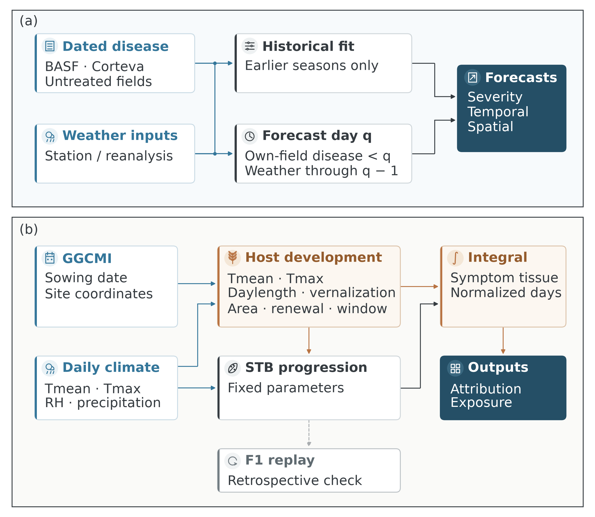
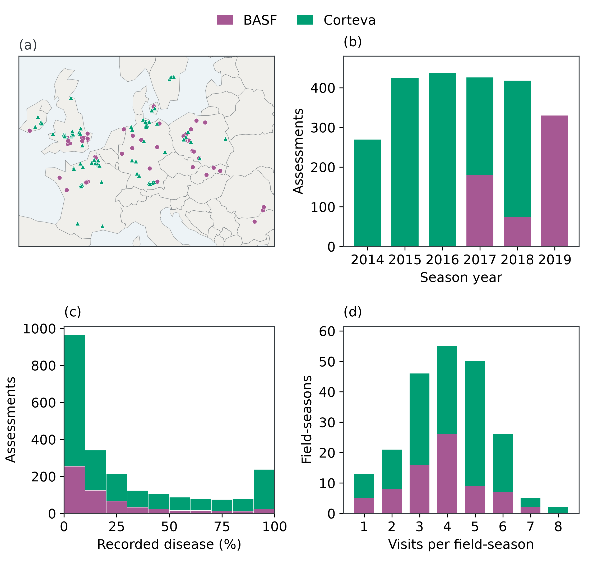
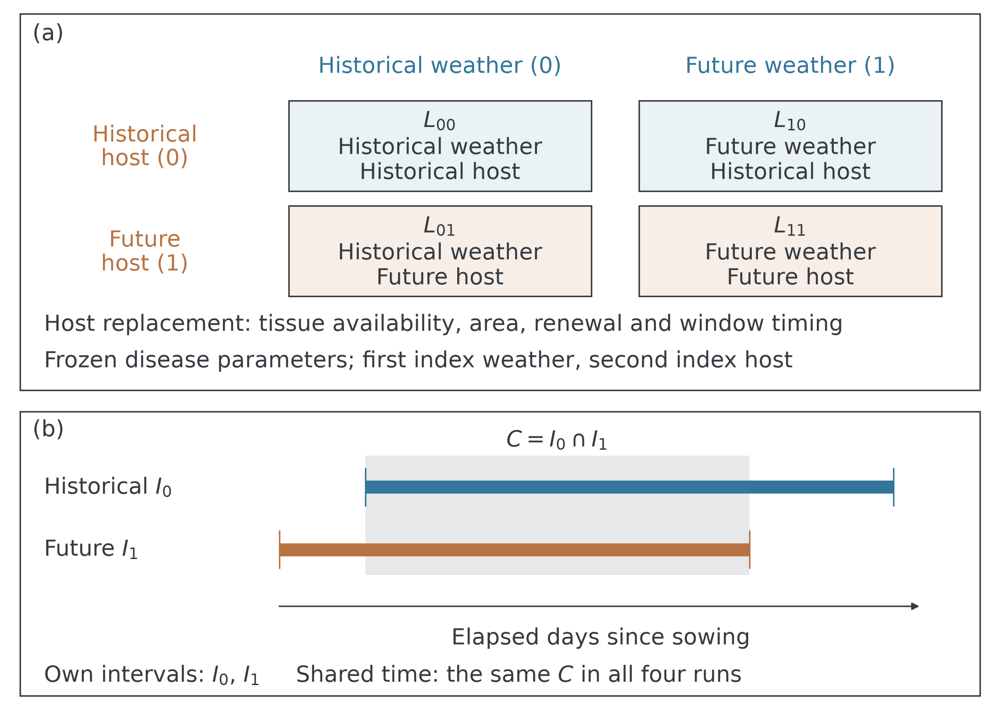
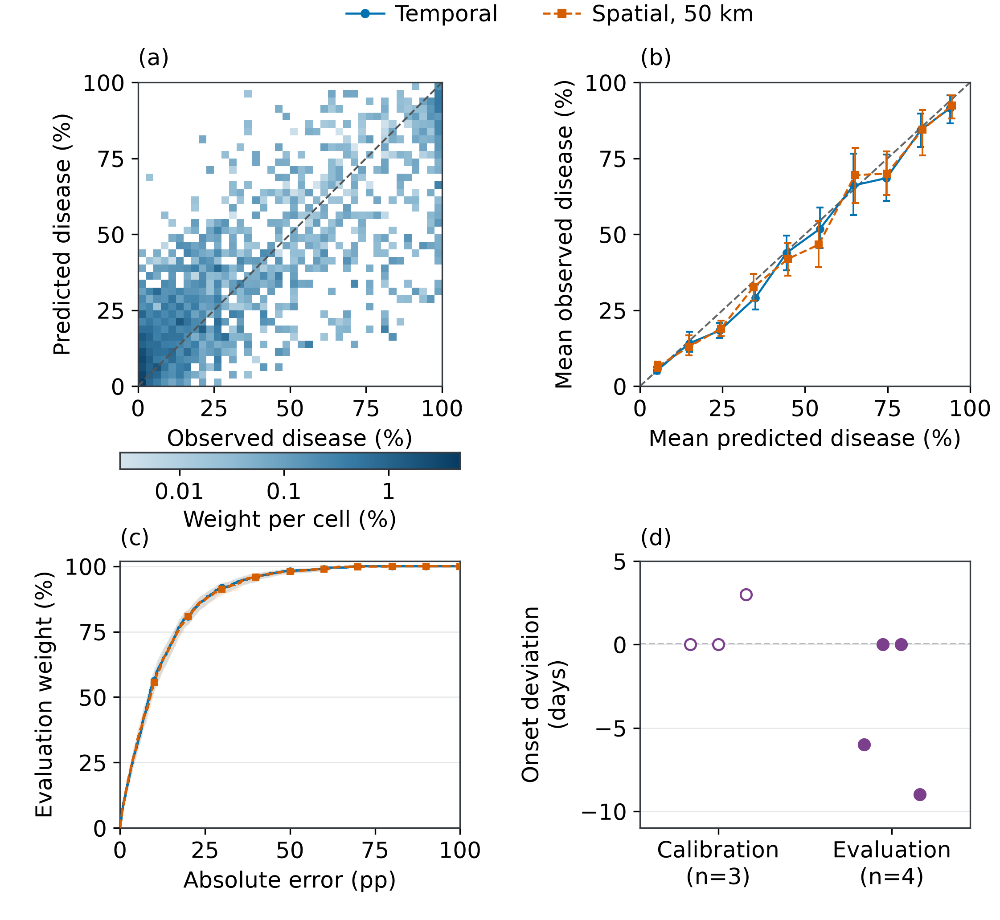
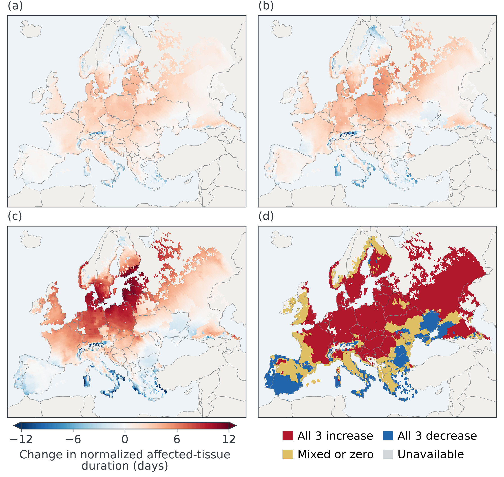
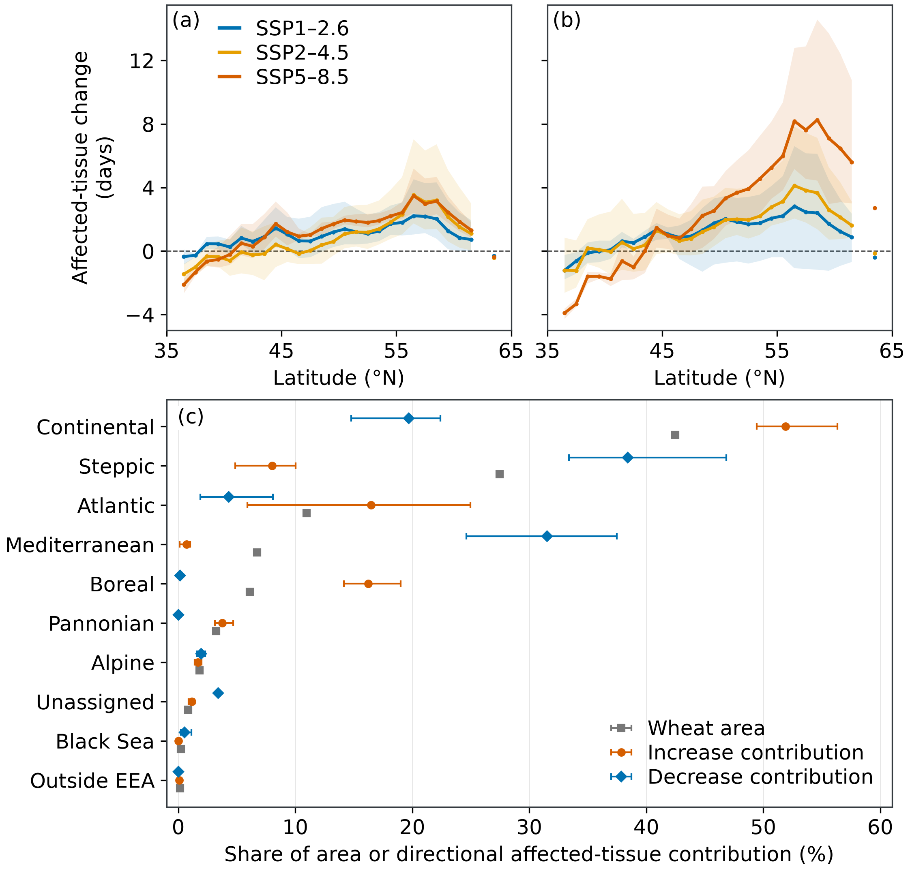
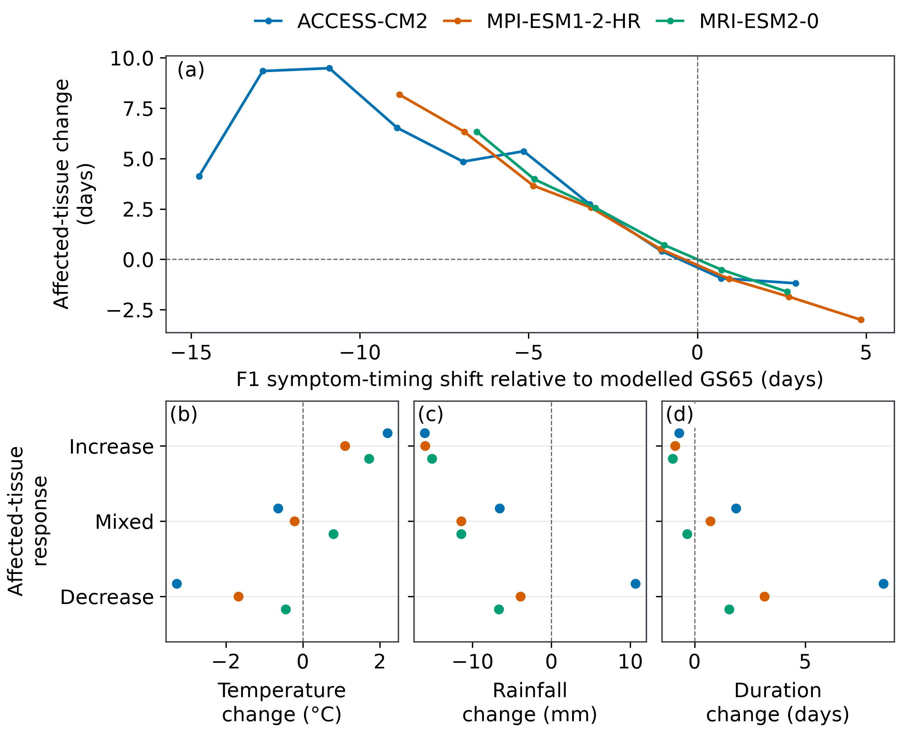
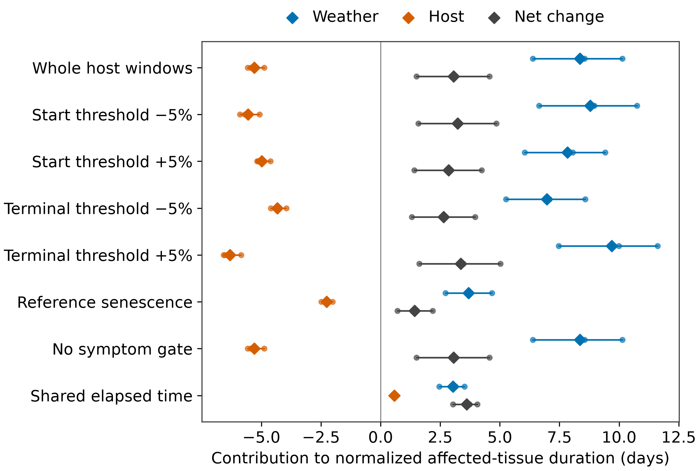
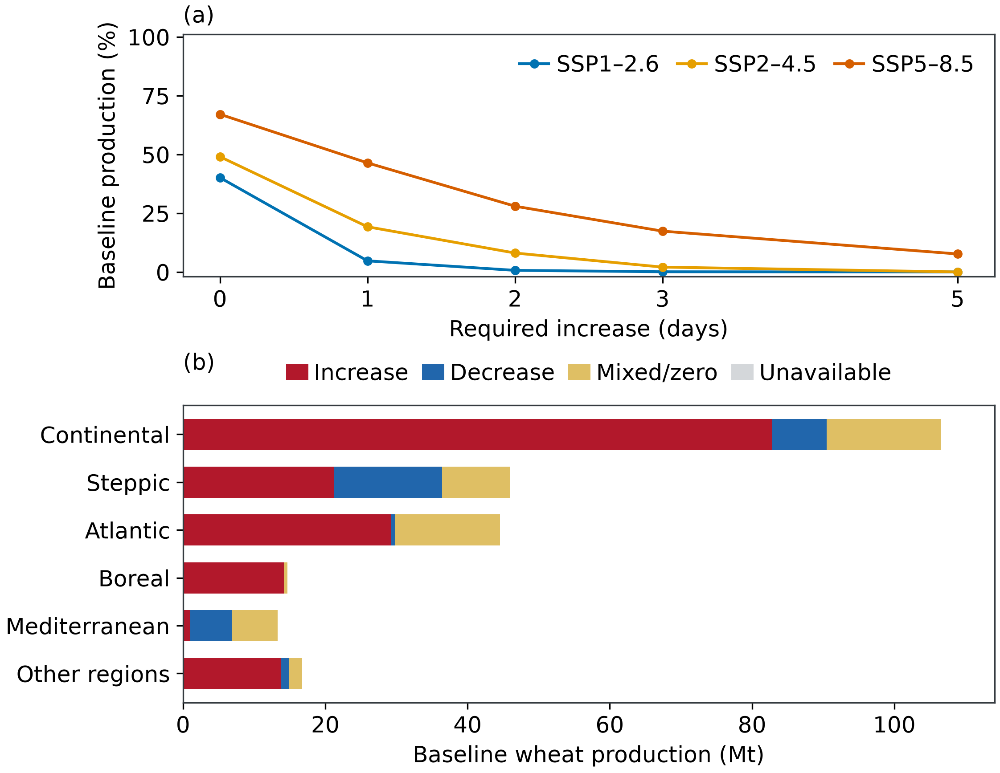
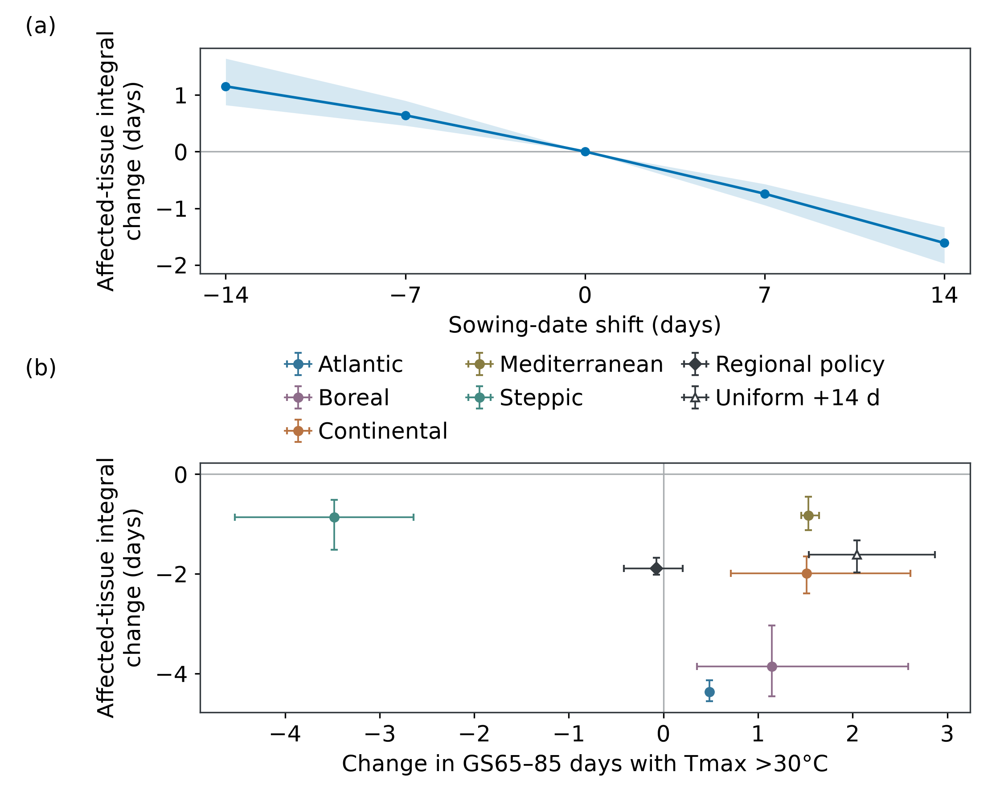

# Host exposure windows shape projected Septoria damage and regional sowing adaptation in European wheat

Gang Zhao*

State Key Laboratory of Soil and Water Conservation and Desertification Control, College of Soil and Water Conservation Science and Engineering, Northwest A&F University, Yangling, Shaanxi 712100, China.

*Correspondence: gang.zhao@nwafu.edu.cn

Telephone: +86 17782509963

ORCID: Gang Zhao, https://orcid.org/0009-0003-0619-5849

Running title: Host windows and regional disease adaptation

## Abstract

Climate change threatens crop health by altering both pathogen-favourable weather and the development of susceptible host tissue. How these shifts redistribute accumulated disease damage, alter host attribution and constrain regional adaptation remains insufficiently resolved. Coupled wheat–Septoria simulations projected impacts across European wheat-growing areas under three climate models and emissions pathways, integrating host–weather attribution, matched symptom-timing diagnostics, fixed-production exposure and bounded sowing-date experiments. Late-century SSP5–8.5 increased the harvested-area-weighted normalized affected-tissue integral by 2.66 days relative to 1991–2020. The 50–60°N belt contained 44.3% of fixed wheat area but supplied 68.6% of the positive damage contribution. Increased damage co-occurred with reduced rainfall during the modelled developmental window over 67.5–70.1% of paired area–time support, and earlier symptoms relative to host development accompanied greater damage. On identical season pairs, the host contribution changed from −5.30 days under whole developmental windows to +0.57 days during their shared elapsed time. Regional sowing choices selected using two climate models and evaluated in the third reduced the future own-window integral by 1.89 days on broad complete-season support, with a 14-day advance in the Steppic region and delays in four other eligible regions. A uniform 14-day delay also reduced the integral but increased exposure to maximum temperatures above 30°C by 2.05 days. Choices reached tested bounds and changed with support restrictions; local feasibility, physiological canopy loss and grain-yield benefits remain unverified. Host exposure windows shape projected disease geography and attribution; adaptation comparisons require explicit temporal support and joint assessment of disease, heat and production.

Keywords: climate change; wheat; Septoria tritici blotch; host phenology; disease exposure; exposure windows; regional adaptation; sowing date; production exposure

## Introduction

Climate change alters the development and environmental conditions experienced by crops and their pathogens (Garrett et al., 2006; Singh et al., 2023). Pathogens and pests impose a substantial burden on food production (Savary et al., 2019). Septoria tritici blotch (STB), caused by *Zymoseptoria tritici*, is a major foliar disease of European wheat. Its consequences depend on the timing and extent of leaf damage, the crop's capacity to tolerate that damage and the production located within affected environments. Weather suitability, visible symptoms, functional canopy loss and harvested yield therefore describe related but distinct biological outcomes (Savary et al., 2006). Emerging fungal threats and geographic shifts in pests and pathogens increase the importance of separating these outcomes in climate-impact assessments (Fisher et al., 2012; Bebber et al., 2013; Bebber, 2015; Fones et al., 2020).

Temperature-based assessments identify changes in infection opportunity, whereas coupled crop–disease models also represent the host tissue available to an epidemic. Climate-related changes in pathogen suitability consequently do not uniquely determine accumulated crop damage (Chaloner et al., 2021; Pequeno et al., 2024). English wheat observations support separate weather relationships for STB occurrence and severity, with rainfall during stem elongation contributing to severity (Pietravalle et al., 2003). Controlled experiments show nonlinear latent-period responses to leaf temperature and differences among pathogen isolates and leaf layers (Bernard et al., 2013). Global evidence also indicates substantial variation and non-additivity in combined climate–pathogen responses (Gallego-Tévar et al., 2024). These findings motivate analysis of the environmental and developmental conditions under which tissue damage accumulates, rather than reliance on infection opportunity or symptom presence alone.

Host development changes the timing of susceptible tissue relative to seasonal weather. Wheat flowering responds to genotype-specific vernalization and photoperiod requirements (Zheng et al., 2016). European phenological observations show advances in developmental dates, while German wheat records demonstrate that developmental phases need not change uniformly (Bönecke et al., 2020; Menzel et al., 2020). Crop-calendar responses have altered projected disease-risk trajectories in potato late-blight simulations (Sparks et al., 2014). In wheat, apparent cultivar differences in STB timing referenced to sowing disappeared when expressed relative to flowering in an earlier experimental modelling study (Robert et al., 2004). A warmer calendar climate can therefore expose a crop to a different within-season environment if its development also shifts. Temperature and rainfall accumulated between developmental endpoints jointly reflect weather, the dates of those endpoints and their separation.

Healthy-area duration integrates healthy leaf area through time; healthy-area absorption additionally accounts for intercepted radiation (Waggoner & Berger, 1987). These quantities connect epidemic timing with canopy function when leaf area, senescence and the damage-to-function relationship are supported. Wheat tolerance further depends on canopy architecture, assimilate reserves and source–sink balance (van den Berg et al., 2017). A normalized symptom-tissue integral makes exposure accounting explicit but does not establish physiological loss or disease-specific grain loss. This distinction permits mechanistic interpretation of a coupled model while retaining the empirical measurements required for a production-impact claim.

Attribution becomes more difficult when host development defines the integration interval. Replacing a historical host trajectory with a future trajectory changes tissue availability, renewal and the dates over which damage is accumulated. A contribution calculated over each trajectory's own developmental window includes these changes in exposure support. Restriction to elapsed time shared by both windows instead describes responses during their overlap. Neither calculation isolates a physiological protection mechanism. Even a window of nearly unchanged duration can move through a different part of the weather season, while the tissue states admitted within it also change. Explicit season, spatial and integration support is therefore necessary for interpreting the host contribution to projected damage.

Sowing adaptation creates a related but distinct comparison. Changing a management date under the same weather sequence can alter disease exposure and the temperature or water conditions experienced during crop development. Climate-driven phenology under fixed management is not itself an adaptation benefit. Crop-model experiments distinguish timely, delayed and absent adjustment of growing periods because these choices can have different productivity consequences (Minoli et al., 2022). The timing of crop operations also interacts with other components of a cropping system (McDonald et al., 2022). Commercial-wheat observations also associate STB severity with sowing date, varietal resistance and fungicide efficacy (van den Bosch et al., 2026). A disease-minimizing sowing shift consequently requires scrutiny of climatic tradeoffs, feasible local calendars and the seasons retained by the comparison.

The European wheat case addresses three connected questions: where projected STB-associated tissue damage becomes concentrated; how symptom timing, host windows and their integration support organize that response; and whether regional sowing choices reduce the modelled disease proxy without uniformly increasing heat exposure. A retained process formulation supplies continental projections, while factorial host–weather substitutions and bounded sowing experiments distinguish climate-driven development from management changes. Fixed present-day production weights describe the agricultural geography of exposure. Separate retrospective field monitoring and component checks define empirical support for observed disease endpoints, without transferring observation-conditioned prediction skill to autonomous climate responses.

## Materials and methods

### Study workflow and information settings

Retrospective monitoring and autonomous climate simulation used separate information settings and endpoints (Fig. 1). Monitoring admitted strictly earlier own-field disease observations, while continental simulations relied on daily climate, imposed sowing and simulated host development. The original flag-leaf replay supplied a separate retrospective check of retained state arithmetic. Its observations were not assimilated into future-season calculations.

### Field observations and sampling design

The retained monitoring cohort contained 2,304 assessments from 218 field-seasons at 128 source locations during 2014–2019 (Fig. 2). BASF supplied 584 assessments from 73 field-seasons at 53 locations, and Corteva supplied 1,720 assessments from 145 field-seasons at 75 locations. Each assessment represented one field, date and source-native leaf category after aggregation of eligible source rows. The geographical, temporal and disease-score distributions described this retained sample; they were not weighted estimates of European disease prevalence. Repeated sampling ranged from one to eight assessment dates per field-season. The two evaluation designs subsequently assessed the same 2,017 records, which were counted once in the cohort description (Holst, 2022; Holst & Donner, 2022).

Eligibility required an explicit untreated designation and zero reported fungicide applications. Treated and unspecified treatment labels were excluded, including records labelled treated despite a zero spray count. Consequently, the retained cohort represented one management condition and supplied no treatment-response contrast. Original source-row counts did not establish independent biological replicates. Native leaf codes and recorded percentage-score definitions retained their source qualifications; only independently documented BASF code zero identified the flag-leaf endpoint.

### Study domain, climate and management scenario

Spatial simulations were restricted to 0.25° cells with positive harvested wheat area in SPAM2020, yielding 14,941 wheat-containing cells. Land-use data defined the simulation domain, while weather, crop calendars and the coupled model determined the wheat response within each cell. Area-weighted summaries represented the wheat component of these mixed-land-use cells; the surrounding non-wheat land contributed no harvested-wheat-area weight. The GGCMI winter-wheat rainfed calendar was available for 14,932 cells; nine cells lacked simulation outcomes. Fixed harvested-area weights represented the spatial distribution of wheat. Applying a winter-wheat rainfed calendar to the all-wheat mask defined a common crop-management scenario rather than a reconstruction of observed management in every cell. SPAM2020 production weights represented circa-2020 wheat production, based on source statistics centred on 2019–2021. Future changes in cropped area, crop type, irrigation and production were outside the scenario (Jägermeyr et al., 2021; International Food Policy Research Institute [IFPRI], 2026).

Daily NEX-GDDP-CMIP6 version 2 forcing represented ACCESS-CM2, MPI-ESM1-2-HR and MRI-ESM2-0, each using member r1i1p1f1, under SSP1–2.6, SSP2–4.5 and SSP5–8.5. Harvest periods were 1991–2020, 2031–2060 and 2071–2100. The 810 model–scenario–year combinations covered 12,094,920 calendar-eligible grid-seasons. Historical forcing through 2014 was joined to the corresponding SSP for 2015–2020, retaining scenario-specific reference continuations. The preceding calendar year was included to represent overwintering crops. The provider's bias correction used Princeton meteorological forcing; an additional cell-month adjustment aligned temperature means, mean logit-transformed relative humidity and precipitation means with ERA5 hourly-derived statistics for 1991–2020. Alignment of these monthly summaries does not establish the accuracy of daily extremes or reconstructed within-day moisture (NASA Center for Climate Simulation, 2025).

The disease calculations used daily mean and maximum temperature, relative humidity and total precipitation; the daily rainfall-exposure reconstruction was a modelling assumption. Within-day humidity reconstruction estimated moisture exposure from daily forcing and did not represent measured canopy leaf wetness. Daily air temperature also does not establish the leaf temperature at which latent-period responses were measured experimentally (Bernard et al., 2013). Missing weather and temperatures outside the accepted model range produced unavailable outcomes. Missing calendars, incomplete weather and failure to reach the terminal developmental endpoint retained separate status codes. These cases supplied no zero-disease values. Input identities, alignment coefficients and scientific runtime parameters were held fixed throughout attribution and sensitivity calculations.

### Coupled host and disease formulation

The continental simulations used the retained temperature–photoperiod–vernalization wheat model and frozen STB parameters. Ordered developmental thresholds determined upper-leaf appearance and unfolding; a modelled start threshold and a terminal threshold delimited the primary damage interval. Daily host trajectories determined the availability and renewal of tissue and the weather experienced by each modelled leaf. The disease module represented establishment, progression and visible symptoms. Disease did not feed back on the calculated host-development trajectory. Equations, numerical implementation, parameter values and their calibration provenance are provided in the supplementary model specification and parameter inventory.

The upper-three-leaf reference canopy had maximum leaf area index equal to one, distributed equally among leaves and scaled by unfolding. Actual cultivar-specific leaf area and changes in cultivar resistance were not estimated. The post-latent symptomatic fraction, including nonsporulating, infectious and dead tissue, entered the integral only from each leaf’s first modelled symptom detection. Its mapping to affected reference area was a declared accounting assumption, evaluated by an inclusive daily rectangle sum. Latent tissue was excluded. The primary quantity was therefore a normalized affected-tissue integral, also retained under its original normalized healthy-area-duration-loss identifier. It was not a measured physiological loss of healthy area. Changes in natural senescence were not independently measured or estimated by the retained host policy.

The internal terminal label 85 denotes the retained numerical developmental gate and does not establish observed soft dough. The historical donor documents an internal 85-to-official-87 convention for DWD yellow ripeness; the retained numerical gate does not supply an independently validated soft-dough date. Measured emergence, stem extension, heading and yellow ripeness do not directly validate the assumed start gate, upper-leaf anatomy or natural senescence. The start-to-terminal integral therefore uses modelled developmental endpoints. Alternative endpoint settings are structural diagnostics, not fitted distributions of phenological uncertainty (Deutscher Wetterdienst [DWD], n.d.).

### Damage integrals and paired period summaries

For disease weather \(w\) and host trajectory \(h\), with time measured in elapsed days since sowing, normalized damage was

\[
L_{wh}(I)=\frac{1}{A_{\max}}\int_I\sum_{\ell=1}^{3} A_{h\ell}(t)\,d_{wh\ell}(t)\,\mathrm{d}t,
\]

where \(A_{h\ell}(t)\) is reference leaf area, \(d_{wh\ell}(t)\) is the modelled affected fraction admitted by the damage-accounting rule, and \(A_{\max}=1\) is maximum reference upper-canopy leaf area. The units are equivalent days of reference tissue affected. The primary interval \(I_h\) extended from the modelled start gate to the terminal stage. Stem-extension-to-terminal integration supplied an alternative endpoint. Symptom occurrence and first-symptom timing were separate outcomes; an infected or symptomatic season did not imply a specified magnitude of integrated damage.

Each future harvest year was paired with the corresponding position in its model- and scenario-specific 30-year historical period. This pairing compared period distributions and did not identify matched historical and future weather events. Only finite paired metric values entered a difference. For cell \(i\), let \(n_i\) denote the number of valid pairs and \(\overline{\Delta L}_i\) their mean difference. Within each climate model, domain means were weighted by fixed harvested area times \(n_i\). Three climate-model means then received equal weight. Different metrics could have different valid pair populations; a common population was required when timing components were compared directly.

Maps retained the native grid without interpolation into unavailable cells. Coloured footprints represented wheat-containing climate cells rather than mapped field boundaries or continuous wheat cover. European Environment Agency (EEA) biogeographical regions were assigned from wheat-cell centroids. Directional area shares used cells with complete three-model estimates and fixed harvested-area weights. Full-grid quantities had no spatial Monte Carlo sampling error. The range of three climate-model values represented the spread of the selected models and supplied no probability interval for future damage (EEA, 2016).

### Weather–host attribution and common support

The four weather–host combinations and their integration intervals define the factorial design (Fig. 3).

Four simulations combined historical or future disease weather, \(w\in\{0,1\}\), with historical or future host trajectories, \(h\in\{0,1\}\). The host replacement included tissue availability, area, renewal and the stage-defined integration window. Weather and host Shapley contributions were

\[
\phi_W=\tfrac{1}{2}\{(L_{10}-L_{00})+(L_{11}-L_{01})\},
\qquad
\phi_H=\tfrac{1}{2}\{(L_{01}-L_{00})+(L_{11}-L_{10})\}.
\]

Each whole-window term used its host-specific interval \(I_h\); common-overlap terms instead used \(C\). Their sum equalled \(L_{11}-L_{00}\), allocating half the interaction to each contribution. These quantities described counterfactual changes within the model and did not identify causal field effects or management intervention benefits. The sampled design contained 64 harvested-area-proportional draws at 62 unique cells. Every climate model and each historical harvest year from 1991 to 2020 was paired to the year 80 years later under SSP5–8.5.

Eight fixed settings comprised the original accounting, separate ±5% changes in the start and terminal developmental thresholds, reference-only linear senescence, accounting without the symptom-detection gate, and common-overlap integration. Reference-only senescence declined linearly from one at flowering to zero at the terminal stage without changing simulated tissue states. The common-overlap calculation used the same interval \(C=I_0\cap I_1\) in actual elapsed days since sowing for all four weather–host combinations. Neither host trajectory was extended beyond its reached window. Pairs without an available overlap remained unavailable. These settings were chosen diagnostics, with no fitted sampling distribution over assumptions.

Within-setting attribution required all four corners to be valid. Cross-setting comparisons additionally retained only identical model–draw–year pairs valid in every setting. Each climate-model estimate was an area–time ratio on these pairs, followed by equal model weighting. The comparison therefore distinguished changes in the integration estimand from changes in the season population. Original within-setting estimates, exclusions and common-support estimates retained separate records. Tissue accounting, four-corner balance and reproduction of the original baseline supplied numerical consistency checks.

The distinction between integration estimands follows directly from the loss definition. Writing \(q_{wh}(t)=\sum_\ell A_{h\ell}(t)d_{wh\ell}(t)/A_{\max}\), the diagonal whole-window difference satisfies

\[
L_{11}(I_1)-L_{00}(I_0)
=\int_C(q_{11}-q_{00})\,\mathrm{d}t
+\int_{I_1\setminus C}q_{11}\,\mathrm{d}t
-\int_{I_0\setminus C}q_{00}\,\mathrm{d}t.
\]

The first term compares damage over shared elapsed time. The remaining terms account for damage in the non-overlapping parts of the host windows. This identity does not assign the observed sign change to window duration alone: tissue states and their alignment with weather can change concurrently. The same support distinction applies to each factorial contrast and hence to the host and weather attribution.

### Production exposure

Baseline production exposure summed fixed SPAM2020 production in cells meeting a climate-response criterion. Ensemble-mean exposure required a positive equally weighted three-model mean change; unanimous exposure required positive changes in every model. Additional thresholds required every model to exceed a specified normalized-damage increase. The zero-, one- and two-day criteria described magnitude sensitivity without assigning biological or economic damage thresholds. Every exposure share retained the complete reference-production denominator, including production in cells with unavailable responses. Native source-country fractions partitioned production in border cells, while environmental regions retained the centroid assignment (IFPRI, 2026).

Production-weighted continuous changes used fixed production times valid-pair counts within each model before equal model weighting. Model composition diagnostics considered all three models, each omitted-model pair and individual members on fixed three-model availability support. These comparisons assessed dependence on the selected ensemble and did not privilege a reduced ensemble. Rainfed production and constrained winter-wheat allocation supplied separate crop-representation sensitivities. Exposure denoted baseline production located in affected cells; no multiplication of damage days by grain-yield coefficients entered the primary results.

### Geographic concentration and developmental-window associations

Latitude and environmental-zone summaries retained fixed harvested area and valid historical–future year-pair counts within each climate model, followed by equal model weighting. Positive directional contributions summed harvested area × valid-pair fraction × positive cell mean change; negative-magnitude contributions used the absolute negative change. Each directional share had its own complete domain denominator. A high positive contribution could therefore reflect area, change magnitude or both. These geographic contributions were distinct from factorial weather–host attribution.

Changes in F1 symptom timing relative to the modelled GS65 gate were compared with affected-tissue changes only where their valid-year-pair populations matched exactly. Within each of 18 model–scenario–period combinations, weighted linear associations included changes in GS65–terminal mean temperature, accumulated rainfall and duration, with relative symptom timing added separately. Five-degree spatial-block resampling with 500 replicates described sensitivity of coefficients to spatial composition. Out-of-block comparisons used 5° and 10° blocks and three fold assignments. These diagnostics described covariation among internal model states and did not test independent disease predictions or identify causal mediation. Window climate referred to the respective modelled developmental intervals, rather than a fixed calendar season. Full-domain support and the retained timing subset remained separate.

### Bounded sowing-date comparisons

Sowing-date shifts of −14, −7, 0, +7 and +14 days were imposed on the 64-draw, 62-cell sampled design under historical conditions and late-century SSP5–8.5. Every option used the identical realized weather for its model, cell and season; only sowing date changed. All developmental, disease and weather-alignment parameters remained fixed. Calendar-year, forcing-availability and provider-maturity constraints were retained without clipping or wrapping dates. The ±14-day range was a bounded sensitivity, because the GGCMI calendar supplied no empirically validated local sowing range. Establishment failure, soil workability, winter kill and crop-rotation constraints were outside the formulation.

The own-window endpoint used each option's modelled GS65–terminal interval. The management shared-time endpoint used the intersection of all five option windows on actual calendar dates within the same weather season. This calendar-time intersection differed from the elapsed-since-sowing overlap used in host–weather attribution. The original support required completion and nonempty all-option overlap in both periods and all three climate models. A subsequent support audit retained all complete options on identical draw–year pairs without requiring overlap; this broader population defined the principal own-window management comparison. The original restricted support remained a sensitivity.

A regional shift minimized future own-window damage in two climate models and was evaluated against unchanged sowing in the omitted model. Selection was repeated for each omitted model. Eligible regions required at least three unique cells and 30 draw–years per training model; other regions retained unchanged sowing. The same broadly selected policy was evaluated on both support populations. Modelled window duration, mean temperature, rainfall and days with daily maximum temperature above 30°C supplied descriptive tradeoffs. These exposures were not calibrated heat-stress or yield responses, and selected boundary choices did not establish agronomic or economic optima.

### Observation-conditioned monitoring and empirical endpoint support

The separate retrospective monitoring model corrected a fixed process/history baseline using logit forecast residuals from strictly earlier assessments in the same field. A shared-field Matérn-3/2 covariance and an exponential same-native-code covariance supplied four positive parameters fitted to historical, coordinate-held-out prequential errors. Fractions were clipped to 0.005–0.995 for the logit transformation; predictions without previous field observations preserved the baseline.

All query-day and future disease observations were withheld across native codes, and current-season disease from other fields was excluded. Weather ended on the preceding day. Five chronological and 15 chronology-plus-50-km folds evaluated the same 2,017 assessments from 192 field-seasons at 121 locations. The spatial exclusion addressed geographic transfer rather than a random record partition (Ploton et al., 2020). Coordinate-years received equal weight, divided among fields, native categories and assessments. Predictive \(R^2=1-\mathrm{MSE}_w/\mathrm{Var}_w(y)\) used individual forecasts and the weighted observed mean. Descriptive intervals used 2,000 paired site resamples of fixed predictions; forecast-bin calibration used 1,000. Field-season empirical error distributions gave each field-season one vote.

These were adaptive internal comparisons with realized weather and previously inspected outcomes. Outer statistical fitting used earlier years, while inherited crop-feature transformations retained their archived ancestry; the entire upstream feature pipeline was not independently rebuilt in every fold. Native score definitions and incomplete anatomical mapping remained qualified. Direct replay of 70 original 2019 flag-leaf evaluation records and 45 calibration records supplied a separate retained-process check. Its source membership, weighting alternatives and observed-window integrals remained distinct from monitoring. Neither evaluation calibrated functional canopy damage or grain loss (Holst, 2022; Holst & Donner, 2022; DWD, n.d.).

Forecast calibration grouped predictions into fixed 10-percentage-point bins and compared the original-weight mean prediction with the corresponding mean observation. Observed-mean intervals used 1,000 site resamples and required at least four contributing sites. Absolute-error coverage was the cumulative fraction of original evaluation weight with error at or below each threshold. Curves retained every empirical jump and the full 0–100-percentage-point range. Their 95% percentile intervals used 2,000 paired site resamples, preserving relative assessment weights within each sampled site and applying the same site multiplicities to both evaluation designs. These intervals were conditional on fixed forecasts and excluded fitting and adaptive model-selection uncertainty.

Onset information was classified for all 55 source-identified flag-leaf field-seasons as positive at the first assessment, zero-to-positive, or without a positive assessment. Positive scores occurred in 21 of 22 calibration field-seasons and 31 of 33 evaluation field-seasons; 18 and 27 histories, respectively, were positive at the first assessment. The original 2017–2018 calibration and 2019 evaluation populations remained separate. Daily onset timing was scored for the three calibration and four evaluation histories with a zero before first positive; admissible dates extended from the day after the last zero through the first positive. The process date was the first daily symptomatic-tissue fraction crossing 0.001. Signed interval-excess error was negative before the interval, positive after it and zero within it; its absolute value supplied the reported mean excess. Each field-season received equal weight within its partition. One-sided histories supplied temporal constraints and observation-coverage counts rather than two-sided timing precision. The archived calendar comparison supplied saved evaluation dates; its original fitting implementation was not independently reconstructed. Observation-based detection limits were undocumented.

### Independent yield evidence

Published yield evidence was classified by pathogen attribution, endpoint definition, experimental independence and availability of sampling variances. The 22 annual ARVALIS Performance values were transcribed from printed chart labels and converted from quintals to tonnes per hectare. Equal-year summaries described the published annual distribution because annual trial counts were unavailable. The network's inclusion of rust-dominated trials and changing cultivar groups restricted interpretation to foliar-disease fungicide yield gaps (ARVALIS, 2022, 2024, 2025). Overlapping years in the STB-dominated French trial account were not counted as independent studies (Garnault et al., 2021). Retrieved sources did not supply a compatible independent set of STB-specific grain-yield effects with sampling variances for a new meta-analysis. No coefficient converted the normalized tissue proxy into grain yield.

## Results

### Field evaluations quantified severity skill and symptom-onset timing

The observation-conditioned model achieved temporal and chronology-plus-50-km RMSEs of 17.15 and 17.31 percentage points, with predictive R² of 0.625 and 0.618 on the same 2,017 assessments per design during 2015–2019 (Fig. 4a–c). RMSE differed by 0.9% between designs. Corresponding MAEs were 12.23 and 12.32 percentage points. Paired-site 95% resampling intervals were 15.75–18.56 and 15.85–18.84 for RMSE, and 0.558–0.677 and 0.550–0.671 for R². Error coverage was also similar: 70.18% and 70.40% of the original evaluation weight had absolute errors within 15 percentage points, rising to 80.68% and 80.81% within 20 percentage points (Fig. 4c). These descriptive intervals condition on fixed forecasts after adaptive internal development; subgroup diagnostics retain distinct outcome and field-level populations (Fig. S1).

The separate process-onset check included three calibration histories during 2017–2018 and four original-2019 evaluation histories with zero-to-positive brackets. Mean interval-excess error was 1.00 days in the calibration period and 3.75 days in the evaluation period, with two of three and two of four predictions inside the observed intervals (Fig. 4d). The corresponding bracket widths were 12–29 and 8–18 days. The archived calendar comparison gave 6.25 days for the four evaluation histories. Calibration-period agreement provides development context; the original-2019 evaluation remains a separate population.

### Projected damage concentrated in mid-to-high-latitude wheat environments

The European harvested-area-weighted affected-tissue integral increased under all three emissions pathways (Fig. 5). Late-century changes relative to 1991–2020 were +1.45, +1.55 and +2.66 days under SSP1–2.6, SSP2–4.5 and SSP5–8.5. Under late-century SSP5–8.5, the domain mean rose from 6.30 to 8.95 days, and all three climate models projected increases, ranging from +1.23 to +4.57 days. All models agreed on an increase over 65.2% of fixed wheat area and a decrease over 14.9%.

The 50–60°N belt contained 44.34% of fixed wheat area but supplied 68.59% of the positive damage contribution, with model-specific shares of 66.15–70.27% (Fig. 6). Area- and valid-pair-weighted changes were +4.04 days at 50–55°N and +7.06 at 55–60°N, compared with −2.36 at 35–40°N. All three models projected increases at 45–60°N and decreases at 35–40°N. The Boreal zone supplied 16.23% of the positive contribution from 6.10% of wheat area; the Steppic zone supplied 8.02% from 27.45%. Positive-contribution shares use a separate denominator from area shares.

Accumulated damage changed substantially despite nearly ubiquitous symptom occurrence. Occurrence was 99.73% historically and 99.33% under late-century SSP5–8.5, while normalized damage rose from 18.03% to 26.07% of the reference integral. The spatial redistribution therefore concerned the magnitude and timing of tissue burden rather than the presence of symptoms alone.

### Host-relative symptom timing organized damage across contrasting window climates

On the common full-grid timing population, first symptoms advanced by 30.78 days after sowing, while the modelled GS65 and terminal gates advanced by 27.32 and 27.07 days. Symptoms advanced by 3.46 days relative to GS65, whereas the host-window duration changed by only +0.25 days. Earlier symptoms relative to GS65 consistently accompanied greater affected-tissue change across all 18 model–scenario–period combinations, with weighted correlations from −0.825 to −0.356 on exactly matched year-pair populations (Fig. 7). Adjusted timing coefficients remained negative in every combination after accounting for window temperature, rainfall and duration. These are associations among simulated states; symptom timing also enters the damage operator.

Greater damage coincided with lower accumulated rainfall within the moving host window over 67.51–70.12% of late-century SSP5–8.5 paired area–time support. Cells with unanimous damage increases had windows that were 1.10–2.20°C warmer, received 15.16–16.09 mm less rainfall and were 0.70–1.00 days shorter across climate models. These consistent co-changes linked greater tissue burden to altered host-relative timing and exposure, while window climate incorporated both changing weather and shifted developmental dates.

### Shared-time accounting consistently reversed the host contribution

The factorial comparison retained 4,117 identical model–draw–year pairs across all eight settings, representing 72.02% of requested weighted area–time support (Fig. 8; Fig. S2). Whole-window host and weather contributions were −5.30 and +8.36 normalized affected-tissue days, respectively, giving a net increase of +3.06 days. Restricting all four combinations to shared elapsed time changed the host contribution to +0.57 days and the weather contribution to +3.04 days, with a net shared-time increase of +3.61 days.

The host sign reversal occurred in every climate model: whole-window contributions ranged from −5.57 to −4.88 days, whereas shared-time contributions ranged from +0.54 to +0.58 days. The compared season pairs were unchanged. Host attribution therefore depended consistently on which portions of the exposure windows entered the integral. Whole-window and shared-time effects describe distinct conditional quantities.

### Response intensity and production geography identified different exposure priorities

Under late-century SSP5–8.5, cells with damage increases in all three climate models contained 162.21 million tonnes, or 67.1%, of the fixed 241.84-million-tonne baseline wheat production (Fig. 9). Requiring every model to exceed increases of one and two affected-tissue days reduced the represented shares to 46.4% and 28.0%. Exposure defined by a positive sign consequently covered a substantially larger production footprint than exposure to a specified larger change.

The Boreal region had the largest area-weighted increase but contained 14.65 million tonnes of baseline production, compared with 106.62 million tonnes in the Continental region. Production in cells with unanimous increases was 14.17 and 82.81 million tonnes, respectively. The European production-weighted damage change was +3.36 days, with positive member estimates of +1.38 to +5.69 days. Stronger per-canopy responses and larger represented production thus identified different regional priorities. These amounts locate fixed baseline production in affected cells.

### Regional sowing responses reduced modelled tissue burden across climate models

On complete-season support, regional sowing choices selected using two climate models and evaluated in the omitted model reduced the sampled-design own-window tissue integral by 1.89 days; all three held models showed reductions of 1.68–2.02 days (Fig. 10). The panel retained 1,902 of 1,920 draw–years per model, 62 cells and 99.64% of sampled-design area–time weight. Each eligible region showed a reduction in every held model. Ensemble reductions ranged from 0.82 days in the Mediterranean region to 4.37 days in the Atlantic region.

The selected shifts were +14 days in Atlantic, Boreal, Continental and Mediterranean cells and −14 days in Steppic cells, with agreement among all three omitted-model selections on this support. Across climate models, the four delay regions experienced more GS65–85 days with maximum temperature above 30°C, whereas the Steppic advance reduced that exposure. The regional policy's domain-average change was near zero (−0.08 days; model range −0.42 to +0.20), compared with +2.05 days for a uniform 14-day delay. The uniform delay reduced the tissue integral by 1.61 days. Regional disease responses and their thermal consequences therefore jointly distinguished the management options within this bounded experiment.

## Discussion

The projected European wheat response was concentrated within a mid-to-high-latitude production system rather than distributed uniformly across the wheat domain. The 50–60°N belt contributed disproportionately to positive affected-tissue change, while the southern latitude band declined consistently across the selected climate models. The Boreal region combined strong per-canopy changes with a smaller production base, whereas the Continental region contained much more production exposed to agreed increases. Response intensity, directional agreement and agricultural exposure therefore identified different priorities. The pattern complements pathogen-suitability projections by locating an additional host-dependent pathway between climate and accumulated tissue burden (Chaloner et al., 2021; Pequeno et al., 2024). It remains conditional on one host–disease formulation, a fixed land-use distribution and an imposed rainfed winter-wheat calendar.

Host-relative epidemic timing organized the projected response more clearly than symptom presence or calendar timing alone. Most of the large advance in first symptoms after sowing accompanied earlier host development, while the remaining advance relative to the modelled start gate aligned with greater accumulated damage. Increased damage also co-occurred with lower rainfall inside the modelled window over much of the domain. These results do not imply that rainfall ceased to influence STB. Rainfall before and during tissue emergence affects infection and spread, and the summary window moves through the season as the host develops. A smaller rainfall total within that moving interval is compatible with different prior exposure, earlier symptom arrival and more affected tissue during its retained days. Experimental and observational work already distinguishes host-relative timing, disease occurrence and severity responses (Robert et al., 2004; Pietravalle et al., 2003).

The associations among timing, window climate and damage are properties of the model's internal response structure. They identify consistent co-changes across scenarios and forcing members, rather than independent evidence for causal mediation. Symptom timing contributes directly to the damage operator, and conditioning on matched symptom events excludes some complete seasons. Hotter, drier Mediterranean reference environments were underrepresented in that subset. The decrease-zone window temperatures also need not follow the direction of fixed-calendar warming because the dates and duration defining the comparison have changed. These distinctions are consequential near climatic margins, where missing or unmatched seasons can otherwise appear as small disease responses.

The attribution reversal exposes a second role of host development: it determines both the tissue exposed and the period included in an accumulated endpoint. A negative host contribution under complete developmental windows combined these effects. Restriction to shared elapsed time removed non-overlapping exposure and changed the sign on identical season pairs. This result makes an offset percentage insufficient evidence of physiological buffering. Conversely, excluding historical-only and future-only time does not invalidate those periods as components of a modelled crop season. The two estimands answer different biological questions. The accounting identity separates their terms without declaring either universally correct, and its interpretation extends to impact models in which environmental change alters an exposed life stage, area or period. Numerical effect sizes and regional signs will remain pathosystem- and formulation-dependent (Gallego-Tévar et al., 2024).

The sowing comparisons demonstrate why climate-driven development and management adaptation require separate experiments. Under identical weather, a uniform delay reduced the symptom-tissue proxy while increasing exposure to high maximum temperatures. The regionally selected policy differed in Steppic cells and avoided the same average warming response on broader complete-season support. This contrast identifies a potential regional tradeoff, not a recommendation to advance or delay planting. Both directions reached the tested bounds, and the Steppic choice changed when a shared-window restriction removed complete seasons. Empty overlaps supply no shared-time endpoint; they do not erase valid own-season outcomes. The support sensitivity therefore affects the management comparison itself, rather than merely its statistical precision.

Feasible adaptation depends on processes outside these sowing experiments. Establishment, soil water, winter survival, rotation constraints, cultivar maturity and resistance can all alter the attainable crop response. Future shifts in crop geography and irrigation add further choices. Joint crop and disease evaluation is needed because a reduced foliar-disease proxy can coincide with adverse heat or water exposure, and even a favourable exposure balance does not establish higher grain yield. Wheat experiments and crop-model comparisons show that temperature-related senescence and source–sink responses influence production through pathways not represented by the disease integral (Asseng et al., 2011, 2015; Martre et al., 2015). Timely adjustment of growing periods in broader crop-model analyses likewise concerns explicit management scenarios rather than an automatic benefit of climate-driven phenology (Minoli et al., 2022).

Observed yield evidence confirms agronomic stakes while limiting a quantitative conversion. The 22 ARVALIS Performance annual fungicide yield gaps averaged 1.64 t ha⁻¹ and spanned 0.78–2.71 t ha⁻¹, with between-year SD of 0.58 t ha⁻¹ (Fig. S3; ARVALIS, 2025). The network includes rust-dominated trials and oversamples susceptible or moderately susceptible cultivars; its 2024 comparator was the best single fungicide treatment rather than a demonstrated disease-free crop (ARVALIS, 2022, 2024). These selected annual summaries describe foliar-disease treatment responses, and their variation is not a sampling confidence interval. More pathogen-specific French trials used STB-susceptible, rust-resistant cultivars and attributed losses predominantly to STB across approximately 80 yield trials per year in 20 regions during 2004–2017. Their publicly retrieved account did not provide the paired effect matrix and variances required for a new meta-analysis, and those years overlap the network summaries (Garnault et al., 2021).

Cultivar diversification supplies a separate evidence-supported adaptation avenue. A published synthesis of 406 Danish trials found 10.6% lower STB severity and 1.4% higher yield in cultivar mixtures; untreated-trial responses were 17% and 2.4%, respectively (Kristoffersen et al., 2020). The difference in response magnitudes illustrates why disease reduction and yield benefit are distinct endpoints. Mixture effects include more than the STB-mediated pathway, so they neither calibrate the present normalized integral nor establish the same benefits under future climate. Physiological measurements of green area, senescence, radiation capture, reserves and yield are needed to connect the projected tissue burden with crop function (Waggoner & Berger, 1987; Robert et al., 2004; van den Berg et al., 2017). The 2016 French wheat failure also demonstrates the importance of simultaneous crop physiological and weather-related stresses (Nóia Júnior et al., 2023).

Empirical disease support remains narrower than the continental interpretation. Retrospective monitoring admitted earlier own-field observations and retained moderate conditional tracking, while underpredicting severe outcomes substantially. Its adaptive comparisons and inherited feature ancestry limit the interpretation of resampling intervals. The autonomous projection formulation had distinct parameters and inputs. Its four qualified onset histories supplied a limited timing check, while its severity ranking against the mean benchmark varied with weighting. Measured crop-stage dates did not directly validate the modelled GS65 gate, upper-leaf anatomy, natural senescence or loss of photosynthetic function. Climate-analogue evaluations across environmental gradients can delineate model validity domains and distinguish interpolation from extrapolation (Bauer et al., 2026). A compatible external cohort spanning warmer and drier environments, with repeated upper-leaf onset and canopy observations, is needed to quantify transferability of the projected tissue response. Better monitoring accuracy cannot supply those missing links or define uncertainty bounds for continental disease magnitudes.

The forcing and process assumptions add uncertainty beyond the spread of three climate models. Daily air temperature and reconstructed humidity do not establish leaf temperature or measured leaf wetness; isolate-specific latent-period responses require separate evidence (Bernard et al., 2013). Atmospheric carbon dioxide can affect both host and pathogen, but those biological responses were absent from the retained weather substitution. Controlled acclimation experiments demonstrate such a pathway without providing a universal correction factor (Váry et al., 2015). Crop-model intercomparisons and climate ensembles likewise show that selected-member agreement samples only part of structural and forcing uncertainty (Asseng et al., 2013; Knutti & Sedláček, 2013). Neither fixed accounting alternatives nor within-model spatial resampling converts these omissions into a calibrated probability of future grain loss.

The host exposure window links three aspects of global-change disease risk: the environments a crop experiences, the tissue available when symptoms develop and the temporal support assigned to accumulated damage. Their combination explains why spatial concentration, host attribution and sowing responses can change together while symptom occurrence remains nearly saturated. Explicit whole-window and shared-time quantities preserve these distinct responses. Regional adaptation then depends on the crop seasons retained, competing climatic exposures and empirical functional and harvest endpoints, rather than on a universal host-protection or planting-delay rule.

## Data availability

The numerical data supporting the figures, fixed evaluation memberships, model parameters, climate-adjustment coefficients and source metadata are supplied in the accompanying reproducibility archive. The original disease observations are publicly archived in the Zenodo datasets of Holst (2022) and Holst and Donner (2022). Third-party measurements retain their source definitions and provider terms. Full model equations are supplied in Mathematical_Model_Specification.docx, with numerical settings in the accompanying parameter JSON files. A versioned data and code archive with a persistent identifier will be made publicly available before publication.

## Code availability

Model source code and prior releases are available at https://github.com/SmartAG-Team/paper_cc_impact_wheat_disease. Code and parameter snapshots specific to this study, together with figure data and reproducibility records, are supplied in the accompanying archive. The autonomous climate runtime remains separate from the observation-conditioned monitoring models. REPRODUCIBILITY.txt specifies dependencies, source-backed figure and document builds, unchanged-model replay and numerical integrity checks. Raw third-party forcing products and complete annual simulation caches are identified by source and checksum in the provenance records. Public deposition and assignment of a persistent identifier for this version are pending.

## Author contributions

Gang Zhao: Conceptualization, methodology, supervision, and writing—review and editing.

## Acknowledgements

OpenAI Codex assisted code implementation, numerical consistency checks and English-language drafting. The author is responsible for verifying the scientific content, source attribution and interpretation and for approving the submitted version.

## Funding

This study received no external funding.

## Competing interests

The author declares no competing interests.

## Figure captions

Figure 1. Study workflow and information settings. (a) Retrospective monitoring uses dated untreated BASF/Corteva assessments and qualified station/reanalysis weather. Historical fitting precedes the evaluated season; query context admits strictly earlier own-field disease and weather through the preceding day. Query-day, later and other-field disease is withheld. Five temporal and 15 spatial folds retain 2,017 forecasts per design, 192 field-seasons and 121 sites. Inherited crop-feature ancestry remains qualified. (b) Autonomous simulations use daily mean/maximum temperature, humidity and precipitation, imposed sowing and coordinates. Host development determines tissue availability and exposure windows; disease does not feed back on development. The normalized symptom-tissue integral is not measured physiological loss. The dashed branch is a retrospective flag-leaf replay: 45 calibration and 70 original-2019 evaluation records, without new fitting or independent physiological validation. Monitoring skill is not transferred to climate projections. Icons are conceptual; solid arrows show dependencies and the dashed arrow marks retrospective checking.

Figure 2. Retained field observations and sampling characteristics. (a) All 128 original source locations; circles denote BASF and triangles denote Corteva. (b) Assessment counts by season and source. (c) Recorded disease-score distributions in 10-percentage-point bins; the final bin includes 100%. (d) Unique assessment dates per field-season. The cohort contains 2,304 assessments from 218 field-seasons during 2014–2019. One assessment represents a field, date and source-native leaf category after source-row aggregation. Each is counted once, without evaluation weighting or duplication between validation designs. All retained observations are explicitly untreated, zero-spray controls. Raw source rows and field-seasons are distinct populations; independent biological replicates cannot be identified. Native score and anatomical definitions remain qualified. Natural Earth outlines are geographic references (Natural Earth, n.d.). Map lines delineate study areas and do not necessarily depict accepted national boundaries.

Figure 3. Factorial attribution and integration support. (a) Historical/future disease weather (first subscript) and historical/future host trajectories (second subscript) define four loss terms. Host replacement includes tissue availability, area, renewal and window timing while disease parameters remain fixed. (b) Whole-window losses use each host trajectory’s own interval; shared-time losses use the intersection of those intervals in elapsed days since sowing for all four combinations. Shading indicates common time. Positions are illustrative and unitless rather than observed dates. Both integration definitions answer conditional biological questions; restricting support does not identify a uniquely correct physiological definition or an adaptation benefit.

Figure 4. (a) Temporal monitoring: 2,017 assessments from 192 field-seasons, 2015–2019; cells span 2.5 percentage points on both axes. Colour shows evaluation weight, not prediction error or confidence. (b) Forecast calibration: temporal (blue circles) and 50 km spatial (orange squares). Fixed 10-pp bins; bars: 95% site-bootstrap intervals (1,000 resamples). Grey lines indicate 1:1. (c) Cumulative evaluation weight with absolute error at or below each threshold; bands: 95% paired-site intervals (2,000 resamples). (d) Signed onset interval-excess errors for the separate frozen process: 2017–2018 calibration (hollow, n=3) and 2019 evaluation (filled, n=4), the bracketed histories among 55 flag-leaf field-seasons. Zero is within the interval; negative is early and positive late. Bracket widths are 12–29 and 8–18 days, respectively. Onset calibration cases are development data. Scores retain individual forecasts and original weights. Intervals condition on fixed forecasts. Temporal: RMSE 17.15 (15.75–18.56) pp; predictive R² 0.625 (0.558–0.677). Spatial: RMSE 17.31 (15.85–18.84) pp; predictive R² 0.618 (0.550–0.671).

Figure 5. Climate-response magnitude and direction agreement. (a) SSP1–2.6; (b) SSP2–4.5; (c) SSP5–8.5: equal three-model mean change in normalized affected-tissue duration by 2071–2100 relative to 1991–2020 on valid historical–future paired seasons. (d) Agreement on an increase, decrease or mixed/zero signs under SSP5–8.5; fewer than three model estimates are unavailable. All panels retain 14,941 native cell footprints, EPSG3035 and identical extent. Values describe the wheat component of each mixed-land-use cell. The continuous colour scale is shared by (a)–(c); triangular ends retain values beyond ±12 days. Agreement among selected models is not a probability or independent verification. The output is a normalized symptom-tissue proxy, not measured physiological loss or grain loss. Natural Earth outlines do not enter the model. Map lines delineate study areas and do not necessarily depict accepted national boundaries.

Figure 6. (a, b) Latitude profiles of normalized affected-tissue change for 2031–2060 (a) and 2071–2100 (b), relative to 1991–2020. Lines and markers are equal-three-GCM means of area/valid-pair-weighted one-degree bins; ribbons span GCMs. Display requires at least 0.1% of fixed wheat area and 90% paired-area-time coverage in every GCM; unsupported bins break curves. (c) Fixed wheat-area shares and positive/absolute-negative contribution shares by environmental zone, SSP5–8.5, 2071–2100. Whiskers span GCMs. Each directional denominator sums harvested area × valid-pair fraction × positive or absolute-negative cell change across the domain; each set sums to 100%. Outside EEA and Unassigned cells remain included. Affected-tissue days integrate symptom-gated damage over modelled GS65–85, weighted by reference upper-three-leaf area and normalized by nominal canopy area; they are a symptom-tissue proxy.

Figure 7. Co-changes under SSP5–8.5, 2071–2100 relative to 1991–2020. (a) Area/valid-pair-weighted affected-tissue change in two-day bins of F1 symptom-timing shift relative to modelled GS65; negative shifts indicate earlier symptoms. Equal timing/complete-season valid-pair counts identify identical paired years. Displayed bins represent at least 0.5% of each GCM’s full-domain paired-area weight. (b–d) GCM-specific weighted changes in GS65–85 mean temperature (b), accumulated rainfall (c) and duration (d), grouped by unanimous increase, mixed/zero signs or unanimous decrease in affected-tissue damage. Membership is shared across GCMs; unavailable cells remain in source data. Window climate incorporates shifted phenology. Timing is an internal state entering the tissue endpoint, so associations establish neither independent validation nor causal mediation. GS65 is a modelled gate, not independently validated anatomical anthesis. Affected-tissue days are the normalized symptom-tissue proxy defined in Figure 6. Timing associations describe the matched symptom-event subset; geographic retention is reported in Section S3.

Figure 8. Weather, host and net attribution under eight settings on exactly 4,117 common model–draw–year pairs. Small points represent three climate models, diamonds their equally weighted mean, and horizontal lines their minimum–maximum spread, not confidence intervals. Host replacement includes tissue availability, area, renewal and window timing. Threshold and accounting perturbations are fixed structural diagnostics. Whole-window and shared-time integration answer distinct conditional questions. Retained weighted support is 72.02% and differs among models; its distribution is shown in Figure S2.

Figure 9. Magnitude thresholds and production geography define different aspects of exposure. (a) Percentage of fixed European baseline production where every climate model strictly exceeds each specified increase in normalized affected-tissue days by 2071–2100. Lines connect evaluated thresholds without implying a fitted response. (b) Baseline production partitioned by direction agreement under SSP5–8.5, for the five largest production regions and all remaining regions combined. The complete denominator is 241.845 million tonnes, including unavailable outcomes. These are baseline amounts located in affected cells, not future production or tonnes of grain lost. The imposed scenario is rainfed winter wheat, while production weights describe all reference wheat.

Figure 10. Sowing responses under SSP5–8.5, 2071–2100. (a) Fixed sowing shifts relative to unchanged sowing; lines connect tested options and shading spans three GCMs. (b) Regional disease–heat responses of the leave-one-GCM-out policy, its sampled-design aggregate (diamond), and uniform +14-day delay (open triangle). Points are equal-GCM means; bars show model minima–maxima, not confidence intervals. Own-window integrals are normalized symptom-tissue proxies; heat exposure counts GS65–85 days with Tmax >30°C. Complete-season support retains 1,902/1,920 draw-years per GCM, 62 cells and 99.64% design weight. This support sensitivity is post-audit; original common-calendar results remain in supplementary analyses. Bounded shifts establish neither agronomic nor yield optima.

## References

ARVALIS. (2022). *Choisir & Décider: Céréales à paille, Interventions de printemps 2022–2023, Synthèse nationale*. https://www.arvalis.fr/sites/default/files/medias/pdf/2022-11/_CHOISIR-2_CAP_2022_National_PDFS.pdf

ARVALIS. (2024). *Lutte contre les maladies des céréales à paille: Dossier de presse, 21 novembre 2024*. https://www.arvalis.fr/file-download/download/public/249502

ARVALIS. (2025). *Variétés et interventions de printemps Blé tendre d'hiver 2026: Champagne-Ardenne*. https://www.arvalis.fr/sites/default/files/medias/pdf/2025-12/Choisir2_2025-BTH-CHAMPAGNE-ARDENNE.pdf

Asseng, S., Ewert, F., Martre, P., Rötter, R. P., Lobell, D. B., Cammarano, D., Kimball, B. A., Ottman, M. J., Wall, G. W., White, J. W., Reynolds, M. P., Alderman, P. D., Prasad, P. V. V., Aggarwal, P. K., Anothai, J., Basso, B., Biernath, C., Challinor, A. J., De Sanctis, G., … Zhu, Y. (2015). Rising temperatures reduce global wheat production. *Nature Climate Change, 5*, 143–147. https://doi.org/10.1038/nclimate2470

Asseng, S., Ewert, F., Rosenzweig, C., Jones, J. W., Hatfield, J. L., Ruane, A. C., Boote, K. J., Thorburn, P. J., Rötter, R. P., Cammarano, D., Brisson, N., Basso, B., Martre, P., Aggarwal, P. K., Angulo, C., Bertuzzi, P., Biernath, C., Challinor, A. J., Doltra, J., … Wolf, J. (2013). Uncertainty in simulating wheat yields under climate change. *Nature Climate Change, 3*, 827–832. https://doi.org/10.1038/nclimate1916

Asseng, S., Foster, I., & Turner, N. C. (2011). The impact of temperature variability on wheat yields. *Global Change Biology, 17*, 997–1012. https://doi.org/10.1111/j.1365-2486.2010.02262.x

Bauer, J. N., Schiffers, K., Caspersen, L., Yamane, H., & Luedeling, E. (2026). Rethinking model transferability: Validity domains as a new approach to delineate the limits of bloom date projections. *Global Change Biology, 32*, e70776. https://doi.org/10.1111/gcb.70776

Bebber, D. P. (2015). Range-expanding pests and pathogens in a warming world. *Annual Review of Phytopathology, 53*, 335–356. https://doi.org/10.1146/annurev-phyto-080614-120207

Bebber, D. P., Ramotowski, M. A. T., & Gurr, S. J. (2013). Crop pests and pathogens move polewards in a warming world. *Nature Climate Change, 3*, 985–988. https://doi.org/10.1038/nclimate1990

Bernard, F., Sache, I., Suffert, F., & Chelle, M. (2013). The development of a foliar fungal pathogen does react to leaf temperature! *New Phytologist, 198*, 232–240. https://doi.org/10.1111/nph.12134

Bönecke, E., Breitsameter, L., Brüggemann, N., Chen, T.-W., Feike, T., Kage, H., Kersebaum, K.-C., Piepho, H.-P., & Stützel, H. (2020). Decoupling of impact factors reveals the response of German winter wheat yields to climatic changes. *Global Change Biology, 26*, 3601–3626. https://doi.org/10.1111/gcb.15073

Chaloner, T. M., Gurr, S. J., & Bebber, D. P. (2021). Plant pathogen infection risk tracks global crop yields under climate change. *Nature Climate Change, 11*, 710–715. https://doi.org/10.1038/s41558-021-01104-8

Deutscher Wetterdienst. (n.d.). Phasendefinitionen: Jahresmelder, Landwirtschaft, Kulturpflanzen. DWD Climate Data Center. https://opendata.dwd.de/climate_environment/CDC/observations_germany/phenology/annual_reporters/crops/recent/PH_Beschreibung_Phasendefinition_Jahresmelder_Landwirtschaft_Kulturpflanze.txt

European Environment Agency. (2016). Biogeographical regions, Europe 2016 (Version 1). https://sdi.eea.europa.eu/catalogue/idp/api/records/c6d27566-e699-4d58-a132-bbe3fe01491b

Fisher, M. C., Henk, D. A., Briggs, C. J., Brownstein, J. S., Madoff, L. C., McCraw, S. L., & Gurr, S. J. (2012). Emerging fungal threats to animal, plant and ecosystem health. *Nature, 484*, 186–194. https://doi.org/10.1038/nature10947

Fones, H. N., Bebber, D. P., Chaloner, T. M., Kay, W. T., Steinberg, G., & Gurr, S. J. (2020). Threats to global food security from emerging fungal and oomycete crop pathogens. *Nature Food, 1*, 332–342. https://doi.org/10.1038/s43016-020-0075-0

Gallego-Tévar, B., Gil-Martínez, M., Perea, A., Pérez-Ramos, I. M., & Gómez-Aparicio, L. (2024). Interactive effects of climate change and pathogens on plant performance: A global meta-analysis. *Global Change Biology, 30*, e17535. https://doi.org/10.1111/gcb.17535

Garnault, M., Duplaix, C., Leroux, P., Couleaud, G., David, O., Walker, A.-S., & Carpentier, F. (2021). Large-scale study validates that regional fungicide applications are major determinants of resistance evolution in the wheat pathogen Zymoseptoria tritici in France. *New Phytologist, 229*, 3508–3521. https://doi.org/10.1111/nph.17107

Garrett, K. A., Dendy, S. P., Frank, E. E., Rouse, M. N., & Travers, S. E. (2006). Climate change effects on plant disease: Genomes to ecosystems. *Annual Review of Phytopathology, 44*, 489–509. https://doi.org/10.1146/annurev.phyto.44.070505.143420

Holst, N. (2022). Data from 56 fungicide trials in wheat fields across Europe 2017–2019. Zenodo. https://doi.org/10.5281/zenodo.6521175

Holst, N., & Donner, M. (2022). Data from 168 fungicide trials in wheat fields across Europe 2014–2018. Zenodo. https://doi.org/10.5281/zenodo.6390211

International Food Policy Research Institute. (2026). Global Spatially-Disaggregated Crop Production Statistics Data for 2020, SPAM2020 v2r2. Harvard Dataverse. https://doi.org/10.7910/DVN/SWPENT

Jägermeyr, J., Müller, C., Minoli, S., Ray, D., & Siebert, S. (2021). GGCMI Phase 3 crop calendar. Zenodo. https://doi.org/10.5281/zenodo.5062513

Knutti, R., & Sedláček, J. (2013). Robustness and uncertainties in the new CMIP5 climate model projections. *Nature Climate Change, 3*, 369–373. https://doi.org/10.1038/nclimate1716

Kristoffersen, R., Jørgensen, L. N., Eriksen, L. B., Nielsen, G. C., & Kiær, L. P. (2020). Control of Septoria tritici blotch by winter wheat cultivar mixtures: Meta-analysis of 19 years of cultivar trials. *Field Crops Research, 249*, 107696. https://doi.org/10.1016/j.fcr.2019.107696

Martre, P., Wallach, D., Asseng, S., Ewert, F., Jones, J. W., Rötter, R. P., Boote, K. J., Ruane, A. C., Thorburn, P. J., Cammarano, D., Hatfield, J. L., Rosenzweig, C., Aggarwal, P. K., Angulo, C., Basso, B., Bertuzzi, P., Biernath, C., Brisson, N., Challinor, A. J., … Wolf, J. (2015). Multimodel ensembles of wheat growth: many models are better than one. *Global Change Biology, 21*, 911–925. https://doi.org/10.1111/gcb.12768

McDonald, A. J., Balwinder-Singh, Keil, A., Srivastava, A., Craufurd, P., Kishore, A., Kumar, V., Paudel, G., Singh, S., Singh, A. K., Sohane, R. K., & Malik, R. K. (2022). Time management governs climate resilience and productivity in the coupled rice–wheat cropping systems of eastern India. *Nature Food, 3*, 542–551. https://doi.org/10.1038/s43016-022-00549-0

Menzel, A., Yuan, Y., Matiu, M., Sparks, T., Scheifinger, H., Gehrig, R., & Estrella, N. (2020). Climate change fingerprints in recent European plant phenology. *Global Change Biology, 26*, 2599–2612. https://doi.org/10.1111/gcb.15000

Minoli, S., Jägermeyr, J., Asseng, S., Urfels, A., & Müller, C. (2022). Global crop yields can be lifted by timely adaptation of growing periods to climate change. *Nature Communications, 13*, 7079. https://doi.org/10.1038/s41467-022-34411-5

NASA Center for Climate Simulation. (2025). NEX-GDDP-CMIP6 Version 2 technical note. https://www.nccs.nasa.gov/wp-content/uploads/2025/06/NEX-GDDP-CMIP6-v2-Tech_Note.pdf

Natural Earth. (n.d.). Admin 0 – Countries, 1:110 million cultural vectors. https://www.naturalearthdata.com/downloads/110m-cultural-vectors/110m-admin-0-countries/

Nóia Júnior, R. d. S., Deswarte, J.-C., Cohan, J.-P., Martre, P., van der Velde, M., Lecerf, R., Webber, H., Ewert, F., Ruane, A. C., Slafer, G. A., & Asseng, S. (2023). The extreme 2016 wheat yield failure in France. *Global Change Biology, 29*, 3130–3146. https://doi.org/10.1111/gcb.16662

Pequeno, D. N. L., Ferreira, T. B., Fernandes, J. M. C., Singh, P. K., Pavan, W., Sonder, K., Robertson, R., Krupnik, T. J., Erenstein, O., & Asseng, S. (2024). Production vulnerability to wheat blast disease under climate change. *Nature Climate Change, 14*, 178–183. https://doi.org/10.1038/s41558-023-01902-2

Pietravalle, S., Shaw, M. W., Parker, S. R., & van den Bosch, F. (2003). Modeling of relationships between weather and Septoria tritici epidemics on winter wheat: A critical approach. *Phytopathology, 93*, 1329–1339. https://doi.org/10.1094/PHYTO.2003.93.10.1329

Ploton, P., Mortier, F., Réjou-Méchain, M., Barbier, N., Picard, N., Rossi, V., Dormann, C., Cornu, G., Viennois, G., Bayol, N., Lyapustin, A., Gourlet-Fleury, S., & Pélissier, R. (2020). Spatial validation reveals poor predictive performance of large-scale ecological mapping models. *Nature Communications, 11*, 4540. https://doi.org/10.1038/s41467-020-18321-y

Robert, C., Bancal, M.-O., Nicolas, P., Lannou, C., & Ney, B. (2004). Analysis and modelling of effects of leaf rust and Septoria tritici blotch on wheat growth. *Journal of Experimental Botany, 55*, 1079–1094. https://doi.org/10.1093/jxb/erh108

Savary, S., Teng, P. S., Willocquet, L., & Nutter, F. W., Jr. (2006). Quantification and modeling of crop losses: A review of purposes. *Annual Review of Phytopathology, 44*, 89–112. https://doi.org/10.1146/annurev.phyto.44.070505.143342

Savary, S., Willocquet, L., Pethybridge, S. J., Esker, P., McRoberts, N., & Nelson, A. (2019). The global burden of pathogens and pests on major food crops. *Nature Ecology & Evolution, 3*, 430–439. https://doi.org/10.1038/s41559-018-0793-y

Singh, B. K., Delgado-Baquerizo, M., Egidi, E., Guirado, E., Leach, J. E., Liu, H., & Trivedi, P. (2023). Climate change impacts on plant pathogens, food security and paths forward. *Nature Reviews Microbiology, 21*, 640–656. https://doi.org/10.1038/s41579-023-00900-7

Sparks, A. H., Forbes, G. A., Hijmans, R. J., & Garrett, K. A. (2014). Climate change may have limited effect on global risk of potato late blight. *Global Change Biology, 20*, 3621–3631. https://doi.org/10.1111/gcb.12587

van den Berg, F., Paveley, N. D., Bingham, I. J., & van den Bosch, F. (2017). Physiological traits determining yield tolerance of wheat to foliar diseases. *Phytopathology, 107*, 1468–1478. https://doi.org/10.1094/PHYTO-07-16-0283-R

van den Bosch, F., Helps, J., Sims, I., Paveley, N., Whitworth, L., van den Berg, F., Blake, J., & Smith, J. (2026). Septoria tritici blotch in commercial wheat crops in England: What determines disease severity? *Plant Pathology, 75*, e70157. https://doi.org/10.1111/ppa.70157

Váry, Z., Mullins, E., McElwain, J. C., & Doohan, F. M. (2015). The severity of wheat diseases increases when plants and pathogens are acclimatized to elevated carbon dioxide. *Global Change Biology, 21*, 2661–2669. https://doi.org/10.1111/gcb.12899

Waggoner, P. E., & Berger, R. D. (1987). Defoliation, disease, and growth. *Phytopathology, 77*, 393–398. https://www.apsnet.org/publications/phytopathology/backissues/Documents/1987Articles/phyto77n03_393.pdf

Zheng, B., Chenu, K., & Chapman, S. C. (2016). Velocity of temperature and flowering time in wheat – assisting breeders to keep pace with climate change. *Global Change Biology, 22*, 921–933. https://doi.org/10.1111/gcb.13118
