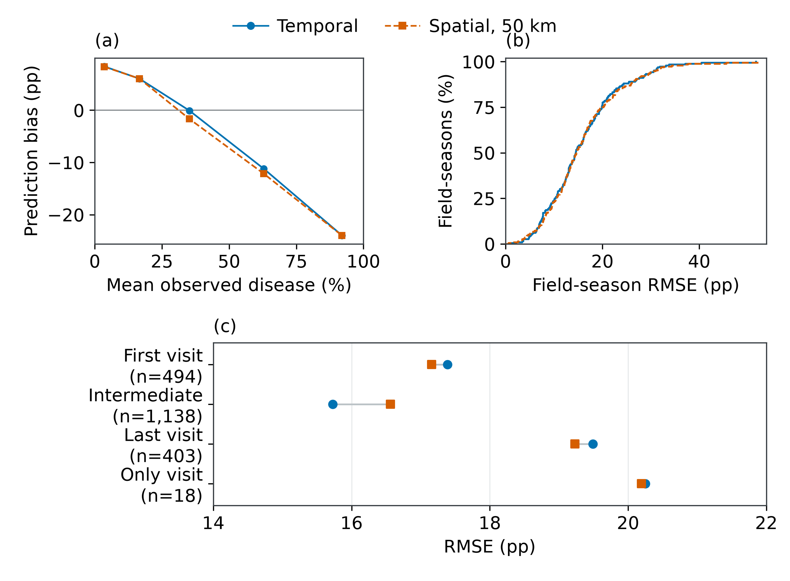
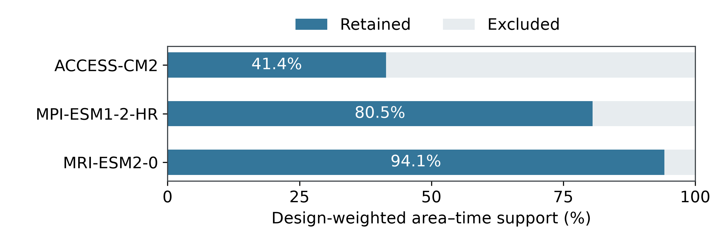
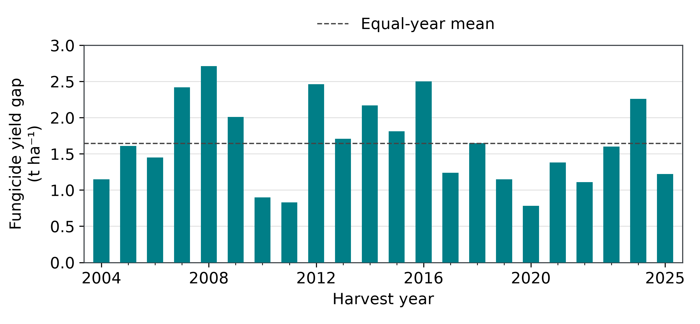

# Supplementary information

*Host exposure windows shape projected Septoria damage and regional sowing adaptation in European wheat*

Gang Zhao

Correspondence: gang.zhao@nwafu.edu.cn

## Contents

S1. Field data and endpoint evaluations

S2. Attribution and common support

S3. Spatial, timing and production support

S4. Sowing adaptation and temporal support

S5. External yield evidence

S6. Parameters and equations

S7. Conditional production-value sensitivity

S8. Reproducibility

Tables S1–S6; Figures S1–S3.

## S1. Field data and endpoint evaluations

### S1.1. Cohorts and information limits

The monitoring cohort contains 2,304 dated untreated disease records from 218 field-seasons; each assessment design uses 2,017 records from 192 field-seasons at 121 locations. One quarantined assessment follows its field's recorded grain endpoint and is excluded from training, conditioning and evaluation. Exclusions are independent of prediction error. Missing cultivar, replicate and anatomical metadata are not inferred from station names or ordinal endpoint codes.

Table S1. Information contracts and interpretation. The rows distinguish model inputs and scientific endpoints.

| Component | Information available | Interpretation |
| --- | --- | --- |
| Monitoring | Earlier own-field disease and recorded stage; realized weather through the preceding day | Nominal source-native severity; conditional retrospective tracking |
| Climate process | Four daily weather variables, imposed sowing and simulated development | Normalized affected tissue; no disease-observation updates |
| F1 check | Original 2019 BASF native code 0 and unchanged original calendar | Anatomically qualified flag leaf; no healthy-area or yield validation |
| Onset check | Source-identified F1 histories in original calibration and evaluation populations | Observation censoring and bracketed symptom timing; distinct from monitoring severity and projected tissue integrals |
| Attribution | Four weather–host corners on identical eight-setting valid pairs | Conditional within-model contrasts, not causal field effects |
| Production exposure | Fixed baseline production and conditional grid responses | Production located in exposed cells; no tonnes of grain lost |

Source versions are BASF Zenodo 6521175 and Corteva Zenodo 6390211. Before cohort, leaf-category and chronology restrictions, the source-native SEPTTR INFECT inventory contains 605 untreated and 552 treated BASF rows, and 7,737 untreated, 25,941 treated and 2,587 treatment-unspecified Corteva rows. These are source rows, not independent trials or biological replicates. Monitoring includes explicitly untreated zero-spray records only; Figure 2 shows source-specific distributions and sampling dates. Source-row identities, units and treatment status remain in the figure data and monitoring ledgers. Source codes and unspecified sampling denominators do not establish an EPPO-compliant common anatomical protocol.

Monitoring is an adaptive internal comparison with earlier own-field disease observations, rather than an untouched confirmation study or autonomous four-weather-variable forecast. Outer statistical splits do not establish historical independence of every inherited crop feature. The separate climate process retains its original 2017–2018 calibration and 2019 evaluation memberships; its fit record declares no later disease-magnitude fitting, but the original optimization trace is unavailable. Crop-stage, source-native score and F1 checks retain distinct populations and endpoints. Observed-window integrals use trapezoids between assessments without extrapolation to unobserved season endpoints. None measures normalized full-season tissue damage, physiological loss or grain yield.

### S1.2. Monitoring model and diagnostics

A fixed process/history baseline is corrected using strictly earlier own-field assessment residuals. The discrepancy model combines field-level Matérn-3/2 covariance with exponential covariance shared by equal native endpoint codes. Four positive covariance-ratio and time-scale parameters minimize hierarchy-weighted historical prequential error in coordinate-excluded baseline predictions. Baseline and observed fractions are clipped to 0.005–0.995 before logit transformation. Without an eligible earlier assessment, correction is zero. Equal native codes establish statistical matching, not common anatomical leaf ranks across providers.

All query-date assessments are withheld together across native codes; later disease and current-season observations from other fields are excluded. Weather ends on the preceding date and follows the qualified station/reanalysis routing, including previously admitted station precipitation; it does not measure canopy leaf wetness. Five chronological and 15 chronology-plus-50-km fold memberships remain fixed. Statistical heads and discrepancy parameters use outer training populations; generic process-state covariates use default disease rates. Inherited crop-feature transformations, earlier recorded crop-stage and weather-duration descriptors retain their documented ancestry. The upstream pipeline was not independently reconstructed within every earlier-year fold, and native endpoint proximity remains an unvalidated numerical proxy in some inherited features. Restored models reproduce saved predictions exactly, demonstrating numerical identity rather than external validity.

Predictive R² equals one minus hierarchy-weighted squared prediction error divided by weighted squared observed deviation from the weighted mean, using individual forecasts. It differs from squared correlation and R² fitted to bin or field means. RMSE and R² intervals use 2,000 paired site resamples (seed 20261024), with identical site multiplicities across designs and the target mean recomputed per resample. Intervals condition on fixed forecasts, excluding refitting and adaptive model-selection uncertainty.

Forecast calibration uses fixed 10-percentage-point prediction bins, 1,000 site resamples (seed 20261023) and at least four contributing sites. Outcome bands instead localize residual errors. Complete field chronology defines first, intermediate, last and only visits; only-visit fields also enter first and last categories. Differences in case mix and disease distributions prevent causal interpretation of an additional visit.

Field-season RMSE retains relative assessment weights. Its empirical cumulative distribution gives each of 192 field-seasons one vote; pooled RMSE retains coordinate-year, field, native-code and assessment hierarchy mass and is not their arithmetic mean. Figure 4b contains forecast-bin calibration. Figure S1 contains outcome-band bias, field-season error distributions and visit context. Unaggregated assessments and site errors retain original identities without spatial smoothing. Sparse sites and differing disease histories preclude causal weather or cultivar interpretation of local errors.

For 286 assessments above 75% severity, temporal and spatial RMSEs were 32.52 and 32.61 percentage points, with biases approximately −23.96 and −23.98. Mean predictions were approximately 68% against 92% observed; first-visit predictive R² was approximately 0.16 and 0.18. Forecast calibration and error distributions retain their distinct populations (Figs. 4b and S1). These scores support conditional retrospective tracking, not autonomous climate-response or grain-yield accuracy.

### S1.3. Flag-leaf replay and archived endpoints

BASF native code 0 is independently documented as first/flag leaf (F1); other codes receive no F1 assignment. Exact field–date matching identifies 115 records: 45 calibration records in 22 fields and 70 original-2019 evaluation records in 33 fields at 27 sites. The forcing/calendar registry contains all 55 fields. The unchanged benchmark is the calibration-source F1 mean, 15.819877%, calculated with original calibration-parent hierarchy weights without evaluation refitting. Rebuilding an F1-only hierarchy gives 20.260516%, a different benchmark.

Forcing comprises daily mean temperature, maximum temperature, mean relative humidity and total precipitation. Original trajectories agree exactly with the causal climate-prefix adapter; saved assessment predictions agree within 1.78×10⁻¹⁵ percentage points. Independently truncated query-day and previous-day prefixes reproduce the corresponding full-prefix states exactly. All 115 queries precede the terminal gate and are therefore independent of eventual completion. This verifies preterminal state arithmetic, not the full-season damage operator or future response magnitude.

Table S2. Retained-process flag-leaf RMSE. Severity units are percentage points and window-integral units are percentage-point days. Weather endpoints and weighting populations remain separate. These records are retrospectively reused, not new independent observations.

| Endpoint | Weather endpoint | Weight population | Process RMSE | Mean RMSE | Records |
| --- | --- | --- | --- | --- | --- |
| Severity | Through query day | F1 conditional | 15.999 | 16.916 | 70 |
| Severity | Through query day | Parent-relative mass | 16.426 | 16.263 | 70 |
| Severity | Through previous day | F1 conditional | 16.392 | 16.916 | 70 |
| Severity | Through previous day | Parent-relative mass | 16.813 | 16.263 | 70 |
| Window integral | Through query day | F1-window conditional | 242.130 | 237.591 | 23 |
| Window integral | Through query day | Parent-window mass | 206.565 | 222.812 | 23 |
| Window integral | Through previous day | F1-window conditional | 247.984 | 237.591 | 23 |
| Window integral | Through previous day | Parent-window mass | 211.639 | 222.812 | 23 |

F1-conditional weights rebuild equal coordinate-year/field/record mass within F1. Parent-relative weights retain the original full-assessment hierarchy within F1, normalized for calculation. Window weights likewise distinguish 23 conditional windows from relative mass in the original 573-window parent. Model–benchmark rankings differ by population. Only one F1 evaluation record exceeds 75% severity and only four histories bracket onset, preventing stable inference about severe epidemics or onset precision. Neither observed-window integrals nor this severe sample validates full-season functional loss; severity is not converted into physiological loss or grain yield.

The larger archived source-native evaluation has separate eligibility and anatomy assumptions: 2,033 assessments, 136 onset histories and 573 windows. Saved raw severity RMSE is 31.193 versus 29.834 for a calibration-leaf mean; onset excess-interval error is 5.322 versus 2.785 days for a calendar benchmark; window-integral RMSE is 933.201 versus 629.479 percentage-point days. These are historical comparisons, distinct from the matched 2,017-record monitoring analysis and not updated independent validation of its source-harmonized cohort. Original source identities and bootstrap interpretation remain archived.

### S1.4. Symptom-onset constraints

The 55 F1 field-seasons comprise 22 calibration field-seasons in 2017–2018 and 33 evaluation field-seasons in 2019, with 115 assessments. Positive scores occur in 21/22 and 31/33, respectively. Calibration contains 18 first-assessment-positive, three zero-to-positive and one never-positive history; evaluation contains 27, four and two. Thus onset is usually left-censored despite frequent positive scores. All histories remain in the observation-coverage ledger.

All three calibration brackets are from 2017; the six 2018 F1 field-seasons are positive at first assessment. Bracket widths are 23, 29 and 12 days; process excess errors are 0, 0 and 3 days, with mean 1.00 day, root-mean-square 1.732 days and two interval-compatible predictions. Figure 4d separates these development cases from the four original evaluation histories; calibration does not enlarge validation. Wider calibration brackets also preclude direct comparison as exact-date generalization error.

Temporal compatibility is 20/22 calibration and 28/33 evaluation field-seasons: 18/18 and 26/27 first-assessment-positive histories, 2/3 and 2/4 bracketed histories, and 0/1 and 0/2 never-positive histories. Left-censored compatibility allows arbitrarily early predictions and therefore does not quantify exact onset accuracy. All three never-positive histories cross the simulated threshold before their last zero; they remain in the coverage denominator and numerical archive.

The 2019 source cohort includes 45 fields at 36 locations across native leaf categories; 12 fields lack qualified F1 observations. The 33 F1 fields retain all 70 severity records, including the one-sided histories. The four brackets are selected solely by observation chronology, independent of forecast error. Figure 2 maps all 128 source locations across 2014–2019, rather than only the four onset histories. Each bracket belongs to a distinct site and receives one vote; widths are 8, 18, 14 and 11 days. Admissible dates exclude the last zero and include the first positive. Simulated onset is the first daily crossing of 0.001 by the nonsporulating, infectious and dead tissue fraction. State day one is the first forcing date; event dates equal sowing plus state day minus one. Bundled four-variable weather and frozen parameters reconstruct all four dates. Prefixes ending on predicted onset reproduce the state exactly; preceding-day prefixes contain no crossing.

Process interval-excess errors are 6, 0, 0 and 9 days; saved calendar errors are 4, 0, 12 and 9 days. Equal-field means including compatible zeros are 3.75 and 6.25 days, root-mean-square errors 5.408 and 7.762 days, and inclusion two of four versus one of four. Errors measure distance outside the observation interval, not from an exact observed date. Saved benchmark dates and errors are reproducible, but its original fitting implementation is unauthenticated in the portable source. Four histories establish neither newly fitted benchmark superiority nor statistical significance. Source rows, intervals, event dates and metrics are in data/onset_evaluation; code/replay_onset.py reconstructs the unchanged model.

### S1.5. Targeted monitoring comparisons

Three historical-training-only candidates addressed low- and high-score errors: joint estimation of bounded logit prior location/slope and four discrepancy parameters; an additional shrinkage coefficient for logit growth between the two latest strictly earlier same-field, same-code dates; and a fixed twofold training-loss multiplier for outcomes above 75% in the joint-mean fit. Evaluation always retained original scientific hierarchy weights.

Candidates used all 2,017 records per design, the original 20 folds, historical coordinate-excluded backbone forecasts and query-day withholding. Current-season other-field observations, satellite inputs, invented cultivar information and query outcomes were excluded. Joint parameters minimized prequential training error. Candidate development followed inspection of reference errors and therefore supplies adaptive internal comparisons, not independent pipeline validation.

Table S3. Changes from the retained monitoring reference, in percentage points. Negative RMSE differences improve the corresponding error measure. Positive severe-bias differences reduce its negative bias toward zero. Severe cases have observed disease above 75%. The table reports candidate changes; reference performance is displayed in Figure 4.

| Candidate | Design | Δ RMSE | Δ severe RMSE | Δ severe bias |
| --- | --- | --- | --- | --- |
| Joint prior mean | Temporal | -0.187 | +0.733 | -1.097 |
| Joint prior mean | Spatial | -0.117 | +1.058 | -1.059 |
| Same-code growth | Temporal | +0.113 | +0.816 | -0.622 |
| Same-code growth | Spatial | +0.199 | +1.122 | -0.857 |
| Severe-priority fit | Temporal | +0.411 | -2.331 | +2.601 |
| Severe-priority fit | Spatial | +0.465 | -2.001 | +2.603 |

Joint-mean fitting lowered overall error but raised severe error in both designs; same-code growth gave no overall gain. Severe-priority fitting reduced severe error and negative bias but increased overall, low-value, first-visit, last-visit and observation-window integral errors. No candidate improved all prespecified core criteria, supporting retention of the original formulation. These are empirical tradeoffs, not theoretical accuracy limits.

Thirteen first-visit severe records contribute approximately 41% of severe squared error under unchanged evaluation weights; missing cultivar, weather and scoring variables remain unverified explanations.

## S2. Attribution and common support

### S2.1. Paired population

The design contains 64 draws at 62 cells, paired over 30 historical/future years and three climate models: 5,760 requested model–draw–year pairs. Complete four-corner results across all eight settings retain 4,117 pairs, or 72.021548% weighted area–time and 71.475694% raw-pair retention. Weighted retention ranges from 41.40% to 94.14% among models. The climate-model-specific weighted fractions differ substantially, as shown in Figure S2. Model-specific retained-mass ratios receive equal ensemble weight.

Figure S2 reports design-weighted area–time support by climate model, distinct from the effect sizes in Figure 8.

### S2.2. Integration and structural settings

Whole-window losses use each host trajectory's own start and terminal dates. Shared-time losses use their elapsed-since-sowing intersection for all four corners, without extending either host beyond its terminal event; empty overlaps remain unavailable. The diagonal difference equals common-time response plus future-only and historical-only exposure, as defined in Equation 3 of the main text. The partition also applies to every factorial contrast. Reversal between these estimands cannot be attributed solely to window length because host area, tissue states and weather alignment also vary within common time.

The eight settings are baseline, separate ±5% start/terminal-clock thresholds, reference-only linear senescence, removal of the symptom-detection gate and shared elapsed-time integration. Reference senescence changes reference area, not disease states; disease parameters remain fixed throughout. On identical pairs, the host contribution changes from negative over whole windows to positive over shared elapsed time. Other threshold/accounting settings retain negative ensemble host contributions on this common population. Whole-window and shared-time contrasts describe complementary modelled exposure quantities rather than a uniquely correct physiological endpoint or adaptation benefit. Settings are structural diagnostics, without calibrated uncertainty probabilities. Independent pair-level recomputation gives maximum additive-balance error 1.07×10⁻¹⁴ days, establishing reproducibility rather than physiological accuracy.

## S3. Spatial, timing and production support

### S3.1. Geographic summaries

Summaries retain fixed land-use denominators, model-specific valid-year-pair counts and equal model aggregation. Continuous responses weight cell harvested area by valid-pair fraction. One-degree latitude bins require at least 0.1% of fixed European wheat area and 90% paired area–time coverage in every model. Unsupported bins stay missing on the complete grid, preventing connected curves or ribbons across gaps. Environmental denominators retain Outside EEA and Unassigned records.

Directional contributions sum weight × positive change or weight × absolute negative change over the full domain; each set of shares sums separately to 100%. These describe change geography rather than weather–host Shapley attribution. Fixed-area shares have a separate denominator.

### S3.2. Matched timing associations

F1 timing is relative to modelled GS65. Associations require timing records drawn from the complete-season population and equal valid-year-pair counts for timing and tissue endpoints, identifying identical years. Missing symptom events remain missing. Coverage is 87.32–96.20% of fixed wheat area across 18 members. Late-century SSP5–8.5 retains 88.66–93.30% overall but 40.22–59.75% in Mediterranean cells. Excluded cells have warmer, drier reference windows, limiting representation of hot, dry margins.

Weighted linear associations include window mean-temperature and accumulated-rainfall changes, then duration and relative symptom timing. Five-fold geographical withholding uses 5° and 10° blocks and three deterministic assignments, yielding 108 model–scenario–period/spatial-design combinations per specification. Longitude/latitude multipliers are (23,13), (17,29) and (11,13), modulo five. Five-degree block resampling uses 500 replicates (seed 20261023); 2.5th–97.5th percentiles represent spatial-composition sensitivity, excluding process, parameter, forcing and observational uncertainty. These associations among internal outputs are not independent observational skill estimates.

GS65–terminal temperature, rainfall and duration reflect forcing and shifting window dates/length; cooler windows need not imply cooler fixed-calendar weather. Co-occurrence of lower rainfall and greater damage uses each member's complete paired area–time denominator. Regimes share three-model sign membership; continuous member responses retain their own weights.

### S3.3. Fixed-production exposure

SPAM2020 reference production supplies the complete denominator, including cells lacking climate responses. Agreement categories partition it; ensemble-mean and unanimous positivity overlap and are not additive. Unanimous magnitude exposure requires every model to strictly exceed the threshold. Figure 9 groups the five largest baseline-production regions and all remaining regions; all ten regional records remain in plotting data. The source setting requires at least one valid pair; alternative minimum-pair/member-composition records remain separate.

The all-wheat mask with an imposed rainfed winter-wheat calendar is a scenario, not reconstruction of observed wheat type, irrigation or future crop geography. Rainfed production is a separate sensitivity. Exposures exclude future production changes, fungicide response, cultivar substitution and inferred grain losses.

With three models, positive-mean exposure declines from 94.7% under SSP1–2.6 to 80.6% under SSP5–8.5, while unanimous exposure rises from 40.1% to 67.1%. Omitting ACCESS-CM2 on fixed three-model support reverses the positive-mean comparison, from 73.3% to 78.3%, demonstrating composition-dependent pathway ordering. Rainfed production represents 98.97% of reference production; incomplete winter-wheat shares add representation uncertainty. These are fixed baseline amounts located in affected cells, not future output or grain lost.

## S4. Sowing adaptation and temporal support

### S4.1. Experiment and admissibility

Sowing shifts are −14, −7, 0, +7 and +14 days, with climate-model weather, cell, season and scientific parameters fixed. The 64 draws cover 62 cells; duplicates retain sampled-design weights. Historical 1991–2020 years pair by index with SSP5–8.5 2071–2100. Unchanged-sowing outputs reproduce original whole-window endpoints within 10⁻¹⁰ affected-tissue days.

Shifted dates preserve the baseline sowing year, remain within forcing coverage and precede provider maturity; they are neither clipped nor wrapped for completion. The static representative calendar is not a validated local sowing range. Missing workability, establishment moisture, winter mortality, rotation, cultivar adaptation and grain-yield responses restrict these options to bounded sensitivities.

### S4.2. Complete-season and shared-calendar populations

The original panel requires all five options to complete, a nonempty all-option GS65–terminal calendar intersection in both periods and three-model validity on identical draw–reference-year pairs. It retains 1,656/1,920 draw–years per model, 57 cells and 77.4551% sampled area–time weight. A subsequent audit requiring completion on identical pairs without mandatory overlap retains 1,902 draw–years, 62 cells and 99.6407% weight. This broader panel defines the principal own-window comparison; the original panel remains a support sensitivity. Both reuse identical simulations, parameters and forcing.

Own-window damage follows each option's developmental interval. Management shared time intersects all five windows on actual calendar dates within a weather season, unlike attribution's historical/future overlap in elapsed days since sowing. Empty calendar intersections leave shared-time damage unavailable, while completed seasons retain valid own-window outcomes; unavailable is distinct from zero damage.

### S4.3. Regional selection and responses

For each omitted model, the other two models select the regional shift minimizing their equally averaged future own-window proxy. Ties favour minimum absolute shift, then the earlier signed value; unchanged sowing wins exact ties. Each training model must contain at least three unique cells and 30 draw–years per region. Sparse Pannonian and Unassigned regions retain unchanged sowing. Evaluation against unchanged sowing in the omitted model measures within-scenario model transfer, not independent field validity.

All three broad-support selections choose +14 days in Atlantic, Boreal, Continental and Mediterranean cells, −14 in Steppic cells and zero in sparse regions. These same choices are evaluated on both panels. Reselecting on restricted support gives +14 instead of −14 days in Steppic cells, whose retained count falls from 12 to nine; Mediterranean counts fall from nine to seven. Thus support changes regional selection, and the two fitted policies are not equivalent.

Uniform +14 days reduces the own-window proxy by 1.6129 days on broad and 2.3300 days on restricted support. The broad-selected policy gives −1.8912 days (model range −2.0190 to −1.6796). On restricted support, the same policy gives −2.1089 own-window and −1.8820 shared-calendar days, distinct temporal endpoints. On broad support, mean window temperature changes by −0.3458°C and maximum-temperature-above-30°C exposure by −0.0764 days (members −0.4185 to +0.2032). Model ranges are not confidence intervals. Duration and exceedance counts are descriptive exposures, not observed grain-fill duration or calibrated physiological stress. Eligible choices reach tested bounds, leaving interior and feasible agronomic optima unidentified.

## S5. External yield evidence

### S5.1. Inventory and annual network series

The inventory comprises 17 primary or archived source records, not 17 independent experiments. Compatibility depends on wheat type/genotype, pathogen attribution, moisture basis, reference treatment, timing, leaf-area definition, thermal/calendar duration, shared controls and effect variances. Source identities remain intact; no compatible independent STB-specific yield-effect set supplies the variances and covariance required for new inverse-variance meta-analysis.

Figure S3 presents 22 annual ARVALIS Performance fungicide yield-gap summaries for 2004–2025. Printed numerical chart labels from the 2025–2026 Champagne-Ardenne report, printed page 8/PDF page 10, supply values without bar-height digitization. Quintals per hectare are divided by ten to obtain tonnes per hectare. Unreported annual trial counts require equal-year descriptive weights. Mean, range, standard deviation and quartiles describe annual network variability, not sampling uncertainty; yearly trial populations and fungicide programs are not standardized or reconstructed (ARVALIS, 2025).

Despite its septoriose chart label, the series is not necessarily STB-specific. The 2022 national synthesis reports disproportionate susceptible/moderately susceptible representation and five yellow-rust-dominated trials. The 2024 source compares the best single full-flag-leaf-emergence fungicide application with no fungicide in 22 SY ADMIRATION trials and separately reports 16 CHEVIGNON trials. Neither uniformly disease-free controls nor paired causal cultivar contrasts are established. The supported endpoint is foliar-disease fungicide response (ARVALIS, 2022, 2024).

### S5.2. Pathogen-specific and archived evidence

Garnault et al. (2021) describe predominantly STB-attributed protected-versus-unsprayed yield differences during 2004–2017 across 20 French regions, averaging approximately 80 trials annually, in STB-susceptible, moderately/highly rust-resistant cultivars. The retrieved publication lacks paired yields and effect variances. Its listed supplement contains model/figure material; direct access was unavailable. Potential annual-network overlap precludes independent replication; multiplying annual averages cannot establish total trials.

The Danish synthesis compares mixtures with mean pure-stand components, a different estimand: 406 trials in 19 trial years during 1995–2017, with 10.6% lower STB and 1.4% higher yield overall, and 17% and 2.4% in untreated trials. These published meta-analytical results do not identify STB mediation or permit repooling with constituent trials (Kristoffersen et al., 2020).

Archived canopy–yield evidence includes 25 cultivar slopes from a shared network, including 21 fixed-effect slopes with standard errors but no cross-cultivar covariance or plot pairs. Eight genotype-by-fungicide means cover STB, stripe rust and mixed disease on five upper leaves, unlike the present three-leaf reference. Other records use ordinal STB scores, genotype contrasts, later fungicide or mixed disease. Tunisian protected references differ by inoculation plus fungicide in one environment. Their treatment/association endpoints do not identify a universal yield coefficient for the normalized symptom-tissue integral.

## S6. Parameters and equations

### S6.1. Disease and source-process settings

Table S4. Retained disease, source and weather-exposure settings. Reference days use the 18 °C clock; source denotes the normalized relative-source unit. Exact parameter identities and full precision accompany the table data.

| Parameter | Value | Unit | Interpretation |
| --- | --- | --- | --- |
| Primary establishment scale | 0.001 | source⁻¹ d⁻¹ | Scales establishment from effective local and imported source. |
| Secondary establishment scale | 10 | d⁻¹ | Scales transmission from infectious tissue. |
| Latent reference duration | 20 | reference d | Continuous-time mean of the latent chain. |
| Latent compartments | 3 | count | Number of sequential latent compartments. |
| Nonsporulating duration | 3 | reference d | Transfer from visible noninfectious to infectious tissue. |
| Infectious duration | 21 | reference d | Transfer from infectious tissue to retained damage. |
| Source maturation timescale | 30 | reference d | Conversion of unready to competent local source. |
| Source decay timescale | 90 | reference d | Ageing of both local-source compartments. |
| Initial competent fraction | 0.5 | fraction | Initial local source assigned to the competent compartment. |
| Rank-distance scale | 2 | rank intervals | Exponential decay with distance between leaf ranks. |
| Rain-response scale | 2 | mm | Scale of the saturating precipitation response. |
| Local airborne weight | 0.1 | weight | Precipitation-independent term in local-source hazard. |
| Contact multiplier | 0.2 | weight | Adjacent infectious-tissue contribution to hazard. |
| Leaf-rank spacing | 120 | TPV units/rank | Spacing between final-leaf visibility thresholds. |
| Imported pressure | 0.1 | relative source | Default pressure when explicit forcing is absent. |
| Rain-duration divisor | 0.45 | mm h⁻¹ | Converts daily precipitation into a wet-duration proxy. |

Establishment scales and source weights are effective equation parameters, not independently measured physiological rates or spore fractions. TPV denotes the temperature–photoperiod–vernalization developmental index. All values retain the original displayed precision.

### S6.2. Developmental thresholds

Table S5. Retained developmental thresholds, in effective TPV units. Stage codes are categorical model labels; their numerical differences do not represent measured anatomical distances. Displayed values retain the original rounding. C32, C33, C37 and C39 are weakly identified in the retained stage fit; C65 is derived, and C85 has no independent validation as soft dough.

| Stage code | Threshold | Interpretation |
| --- | --- | --- |
| 10 | 142.01 | Lower visibility bound for final leaves and prior-day gate for the juvenile canopy. |
| 31 | 542.3 | Starts juvenile withdrawal and the stem-extension diagnostic window. |
| 32 | 633.392 | Ordered stage-only event gate. |
| 33 | 664.496 | Ordered stage-only event gate. |
| 37 | 702.266 | F1 visibility anchor; lower final leaves use rank-spaced offsets. |
| 39 | 807.799 | F1 full unfolding; ends juvenile capacity and sets the unfolding span. |
| 51 | 986.65 | Lower anchor for the derived flowering proxy. |
| 65 | 1165.93 | Derived flowering proxy: C51 + 0.2317(C85 − C51); starts tissue integration. |
| 85 | 1760.39 | Internal terminal gate; ends the season and tissue integration. |

### S6.3. Full equations and endpoint limits

Mathematical_Model_Specification.docx and its Markdown source contain the retained crop, tissue-state, source-pressure and weather-exposure equations. Copied numerical code and exact JSON parameters accompany the review package. Current measurements do not support natural senescence, actual maximum canopy area or physiological conversion of visible disease to photosynthetic-function loss.

## S7. Conditional production-value sensitivity

### S7.1. Scope and assumptions

The exposure basis is the 162.2115 million tonnes of fixed annual reference wheat production in cells where all three climate models project a positive affected-tissue change under SSP5–8.5 in 2071–2100 relative to 1991–2020. The complete 241.8449-million-tonne reference denominator includes production with unavailable responses. The all-wheat production weights and imposed rainfed winter-wheat calendar retain the representation limits in Section S3.3.

Additional proportional yield losses of 0.5%, 1% and 2% and constant wheat prices of €150, €200 and €250 per tonne define illustrative sensitivity scenarios. These values are specified assumptions, without fitted effects, probability distributions or calendar-year price forecasts. Conditional grain loss equals exposed reference production multiplied by the assumed additional yield-loss fraction. Conditional gross-value loss equals that tonnage multiplied by the assumed price. The exposure criterion supplies no calibrated conversion from affected-tissue days to grain yield.

### S7.2. Conditional quantities and economic boundaries

The 1% yield-loss assumption corresponds to 1.622 million tonnes per reference-production year; at the illustrative €200 per tonne price, its gross production-value equivalent is €324.4 million. Alternative assumptions are reported in Table S6. Annual equivalents retain fixed baseline production and constant prices; they do not describe a cumulative 30-year loss or a discounted present value. Gross values exclude treatment and adaptation costs, quality premiums, trade responses and endogenous prices. Disease-specific realized grain losses, net welfare impacts and economic benefits of sowing adaptation remain unestimated.

Table S6. Conditional annual production-value sensitivity for late-century SSP5–8.5 consensus-increase exposure. Additional yield-loss percentages and wheat prices are assumed scenario inputs. Conditional grain loss is expressed in million tonnes (Mt); the three price columns report gross-value equivalents in million euros (€ million). Calculations use the unrounded exposed reference production. Displayed values are rounded after calculation.

| Assumed yield loss (%) | Conditional grain loss (Mt) | €150/t | €200/t | €250/t |
| --- | --- | --- | --- | --- |
| 0.5 | 0.811 | 121.7 | 162.2 | 202.8 |
| 1 | 1.622 | 243.3 | 324.4 | 405.5 |
| 2 | 3.244 | 486.6 | 648.8 | 811.1 |

Machine-readable scenarios, assumptions and source hashes are retained in data/economic_sensitivity/. The exposure analysis stage reproduces these records from the fixed-production results.

## S8. Reproducibility

### S8.1. Numerical provenance

Numbered plotting-data folders retain point identities, panels, variables and units. F1 records preserve original/current identifiers, calibration/evaluation membership, weather endpoints and weights. Source/output hashes distinguish copies from recomputation. Externalized caches retain compatibility paths and recoverable archive manifests; relocation changes no values. The reduced package supplies figure data and direct F1 replay, without establishing independent field validity.

### S8.2. Support and source records

Latitude, developmental-window, sowing and yield records preserve populations, definitions and file identities. Both complete-season and common-calendar adaptation populations retain support selection and regional choices; missing shared intervals differ from zero response. Public-source annual yield labels and chart provenance remain separate from simulated tissue outputs.

## Figure captions

Figure S1. Error concentration and field-scale heterogeneity. (a) Prediction bias within observed-disease bands, positioned at their weighted mean observed value; this outcome-conditioned diagnostic differs from forecast calibration. (b) Cumulative percentage of 192 field-seasons per design at or below each RMSE. Each field-season has one vote and retains original relative assessment weights internally; pooled RMSE is not their arithmetic mean. (c) Paired temporal and spatial RMSE by visit context; the focused 14–22-pp axis includes all estimates. Labels give assessment counts. First and last categories also include only-visit fields. Blue circles/solid lines and orange squares/dashed lines denote temporal and spatial designs; grey segments join estimates for the same context. Visit groups differ in case mix and do not identify the causal value of an extra visit.

Figure S2. Design-weighted area–time support for the identical eight-setting comparison, by climate model. Blue segments show retained support; light grey completes the fixed requested population to 100%. Labels give retained percentages. The denominator retains original design weights and differs from the unweighted count of pairs. Model-specific support qualifies the attribution contrasts.

Figure S3. Annual foliar-disease fungicide yield gaps in the French ARVALIS Performance network, 2004–2025. Bars show published annual treated-minus-untreated grain-yield differences, converted from quintals to tonnes per hectare; the dashed line is the equal-year mean. The source chart labels the series as septoriose, but the network also includes rust-dominated trials and cultivar composition changes. Year-specific fungicide programs are not standardized; disease-free controls are not established. The series therefore describes treatment-associated foliar-disease yield gaps rather than isolated STB losses. Annual sample sizes and sampling variances are unavailable; no confidence intervals are implied. Data: ARVALIS, Choisir & Décider, Interventions de printemps 2025–2026, Champagne-Ardenne, printed p.8 (PDF p.10); pathogen-scope qualification: 2022–2023 Synthèse nationale, printed p.89 (PDF p.90).
